# GaussDB 适配版 DBeaver：图形界面使用说明书

更新日期：2026-11-05。适用于数据库开发、测试及运维人员。本文可直接在代码仓库在线阅读，无需下载 HTML 文件。

适用版本：DBeaver 26.1.5 GaussDB 适配版，应用构建 `26.1.5.20261105r3`，交付修订 `20261105-r3`。在线说明新增分区表与二级分区展示指引；独立 Word 手册 V1.10 同步更新连接、调试、Package 及分区操作指导。源码版本见发布页的构建清单；适用条件和验证范围见第 14 节。

华为云生态仓发布页（完整地址）：https://github.com/huaweicloud-samples/database-gaussdb-ecosystem/releases/tag/dbeaver-gaussdb-26.1.5-kylin-20261105-r3

完整增强源码请下载同一生态仓 Release 中显式命名的 `dbeaver-gaussdb-enhanced-source-20261105-r3.tar.gz`，其中包含匹配的 `dbeaver-common`；GitHub 默认 Source code 链接对应生态仓文档树。

**重要：PL/SQL 调试、包管理测 O/Oracle 兼容库；M 模式只测连接、对象浏览、SQL 和表数据操作。不要在 M 库找 PL/SQL 调试入口。** Package 基础能力要求服务端提供 `gs_package`。错误定位分为“服务端结构化精确诊断”和“已保存源码重放诊断”两级，是否可用由目标服务器实际能力决定；客户端不能使不支持 Package 的服务器突然支持 Package。

中文界面仍有部分英文标签，以下同时列出英文名称。截图取自 26.1.5 Linux 客户端的真实演示环境，展示窗口和操作位置；图中的数据库、对象名、参数及行号可能与本文示例不同，以文字步骤和实际对象为准。截图不包含业务数据或连接密码。

## 阅读导航

建议按以下顺序使用：第 1 节找到调试入口 → 第 2～4 节完成环境和示例准备 → 第 5～9 节使用调试功能 → 第 10 节使用包管理。第 12 节用于排查入口缺失和启动问题。T01～T16 是可重复执行的功能检查编号。

## 1. 找不到调试入口？先按这条最短路径操作

1. 顶部菜单 **帮助（Help）→ 产品配置...（Show Product Configuration...）**，打开产品配置向导。
2. 点“下一步（Next）”，进入功能选择页，勾选 **存储过程调试器（Procedure debugger）**，继续并完成向导。此功能默认关闭；勾选它不是安装其他插件。
3. 如提示重启，保存工作后重启。关闭窗口后后台可能仍运行十几秒，等进程退出再启动，避免工作区锁冲突。
4. 左侧 **数据库导航器（Database Navigator）** 展开正确的 **GaussDB 连接 → 数据库（如显示）→ 模式/Schemas → 目标 schema → 存储过程/Procedures**。
5. **双击一个具体存储过程**，打开对象编辑器，切到“源码/Source”页，并点击源码正文，让这个编辑器获得焦点。不要只选中“存储过程”文件夹，也不要只打开一张普通 SQL 脚本标签。
6. 顶部 **数据库（Database）→ 数据库调试...**，或使用工具栏调试（小虫）图标旁的小三角 → **数据库调试配置...**，打开数据库调试配置。图标主按钮可能运行上次的配置；新建或编辑配置请使用上述入口。“运行配置（Run Configurations）”用于其他启动类型，不是数据库调试入口。
7. 第一次在配置窗口中选择 **Database Debug/数据库调试** 类型，点击左上角“新建配置”图标。按第 5 节选择连接、GaussDB routine、Routine 和输入参数，再点击 **Debug/调试**。

补充入口：导航树中右键具体过程，若出现 **Debug As/调试方式 → 数据库调试**，也可进入。不同菜单布局可能不显示该快捷入口，以“打开过程对象编辑器 → 数据库菜单”为主路径。

如果第 1 步菜单不好找，按 **Ctrl+3**，搜索 `Show Product Configuration`；如果第 6 步仍无入口，先看第 12 节，不要反复更换驱动或安装 PostgreSQL 调试器。

## 2. 开始之前：安装、语言和服务端条件

### 2.1 客户端安装在哪里

DBeaver 安装在用户登录使用的麒麟图形桌面云里，连接远端 GaussDB 服务器；不要求安装到数据库服务器上。客户端不需要 Docker，也不需要 gdb。

- 麒麟 x86_64：本次发布的 Linux tar.gz 文件名含 `linux-x86_64`，解压，进入 `dbeaver` 目录，双击 `dbeaver`，或终端执行 `./dbeaver`。
- 麒麟 ARM64/aarch64：请在对应 Release 中选择文件名含 `linux-aarch64` 的 Linux tar.gz；本次 Release 同时提供 x86_64 和 ARM64 两种包，操作步骤一致。
- Windows x86_64：使用 setup.exe 或解压 ZIP，运行 `dbeaver.exe`。本版 Windows 包尚无实机 GUI 验收。
- 安装包必须与 CPU 和操作系统匹配。`uname -m` 为 `aarch64` 时不能运行 Linux x86_64 包；Windows ARM64、macOS 和 LoongArch 安装包不在本次发布范围。
- 包里自带 Java，不需要将系统 Java 替换掉；JDBC 驱动需客户或供应商提供。

### 2.2 切换中文

首次启动的配置向导，或 **帮助 → 产品配置... → 语言**，选择 **简体中文**，完成向导并点击“应用”，按提示重启；若又出现退出确认，请选择“是”。新版无需额外传入 `-nl`。关闭窗口后请等后台进程退出，不要立即打开第二个实例。

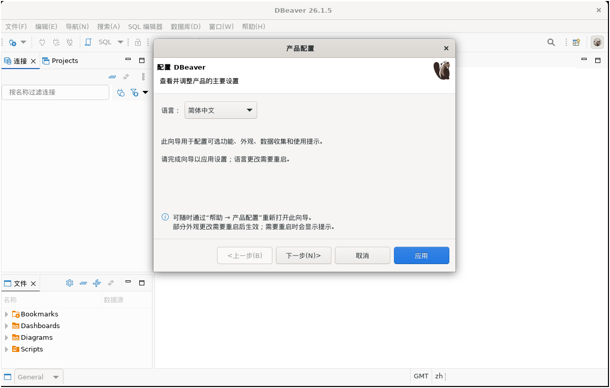

如需临时指定语言，可在程序目录执行 `./dbeaver -nl zh`（Windows 为 `dbeaver.exe -nl zh`）。安装器自身的显示语言与应用运行语言是两个设置；应用语言请在上述产品配置中选择。

长期指定中文：在 `dbeaver.ini` 的 `-vmargs` **之前**添加两行 `-nl` 和 `zh`。它们各占一行；不要重复添加多个语言参数。启动参数优先于界面保存的语言设置。

若以前手工添加过 `-nl`，希望改用界面切换语言，请先移除该选项及紧随其后的语言值。升级请解压到新目录，不要将旧 `dbeaver.ini` 覆盖到新版中。中文资源已补充，但上游新增文本、每日提示正文、已有文件夹名、SQL 标识符和服务器返回的诊断仍可能显示英文，不代表语言设置未生效。

遇到 `Can't lock workspace` 时，取消本次启动，等待旧进程退出；不要忽略锁，不要在进程运行时删除 `.lock` 或工作区。不要使用 `sh dbeaver`/`bash dbeaver` 启动二进制程序。

### 2.3 请 DBA 提供这些信息

服务器地址、端口、数据库名、账号、兼容模式、数据库完整版本、JDBC jar，以及可用于测试的独立库/schema。

调试账号须满足目标版本的调试角色和执行权限要求（包括 `gs_role_pldebugger` 等）；目标库须提供匹配签名的 `DBE_PLDEBUGGER` API。请 DBA 按版本授权，不以授予超级用户替代排查。测试期间不要修改服务端系统表或关闭认证。

所有演示必须在专用测试库执行。带有业务提交、自治事务、发通知、外部接口调用的过程，不适合拿来做回滚演示。

## 3. 新建连接及基础功能测试（T01、T02）

### T01：从零新建连接并确认模式

本节从尚未创建连接的客户端开始。先准备 DBA 提供的数据库主机地址、端口、数据库名、数据库用户名和密码、兼容模式，以及匹配的官方 JDBC jar；若要求 SSL/TLS，还需准备指定的连接方式和证书。连接服务器前，麒麟桌面必须能访问该地址与端口。数据库名、schema 名和桌面云登录账号是不同概念，不可互相代填。

R3 新建连接列表只有一个 **GaussDB** 入口，供 O/A/ORA 与 M 兼容库使用。旧的三个驱动定义从新建列表隐藏，但仍保留供已有连接加载，无需删除重建。默认常用 `gsjdbc4.jar` 使用 `org.postgresql.Driver` 与 `jdbc:postgresql:`；若官方 JAR 实际提供 `com.huawei.gaussdb.jdbc.Driver`，可在驱动管理器中配套使用 `jdbc:gaussdb:`。按 JAR 实际类名选择协议，不凭文件名判断，也不因 O 模式而强制更换驱动包。连接 M 库时显式勾选 **M 兼容库：mCompatible=true、yearIsDateType=true**；O/A/ORA 库不勾。此选项只设置本连接的 JDBC 参数，不修改数据库兼容模式。 URL 模式请勿在查询串中重复填写 `mCompatible` 或 `yearIsDateType`；页面会提示移除冲突项，以保证勾选设置与实际生效值一致。

连接图 C01～C09 来自通过转译运行的麒麟 V10 x86_64 容器，实际连接 GaussDB 507 O/Oracle 兼容演示库。截图用于说明控件位置；`host.docker.internal:55452`、`dbv_connect_20261105` 和 `manual_demo` 是演示环境信息，请替换为 DBA 提供的实际地址、数据库、账号和 schema。

#### T01.1 打开连接向导并选对驱动

1. 在 DBeaver 顶部点击 **数据库 → 新建数据库连接**。这里创建的是客户端连接配置，不是在服务器创建数据库。

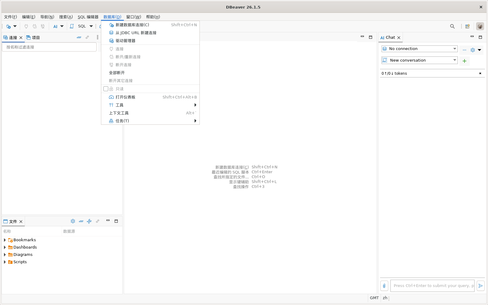

连接图 C01：打开顶部“数据库”菜单，选择“新建数据库连接”。也可使用界面显示的快捷键 Shift+Ctrl+N。

2. 在驱动选择页搜索 `GaussDB`，选择唯一的 **GaussDB** 入口，再点“下一步”。O/Oracle 和 M 兼容库都从此入口创建连接；不要选 PostgreSQL 或 Generic 代替 GaussDB 专用功能。

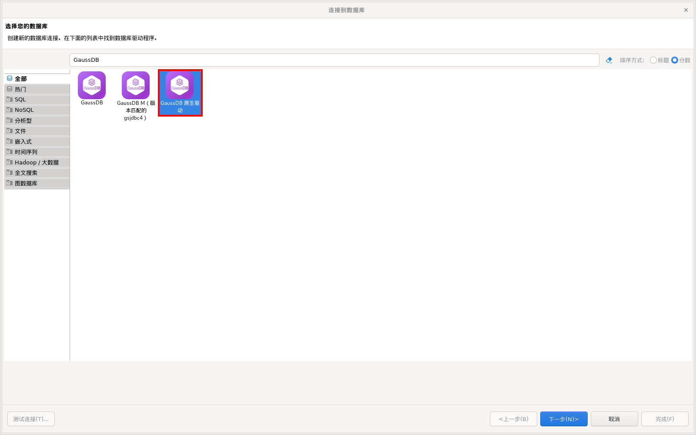

连接图 C02：新版新建连接列表只有一个 GaussDB 入口；图中三个图标属于历史界面，不按图中位置选择。旧驱动定义仍保留供已有连接使用，无需删除重建。

3. 驱动条目不会改变服务器已有数据库的兼容模式。目标库实际是否为 O/Oracle 模式，仍须在连接后查询确认。

#### T01.2 在内网添加官方 JDBC 驱动

1. 将供应商或 DBA 提供的匹配 JDBC jar 复制到**当前麒麟桌面能够读取的本地目录**。文件选择框读取的是运行 DBeaver 的桌面文件系统，不是 GaussDB 服务器目录。
2. 在连接设置页右下方点击 **编辑驱动设置**，进入驱动编辑器顶部的 **库/Libraries** 页。若内网弹出在线下载提示，先取消在线下载，按本节添加本地文件。
3. 先检查库列表。使用供应商提供的匹配 GaussDB JDBC jar，不混用多个冲突版本。同一个官方 gsjdbc4 包可以服务其支持的 A/O 和 M 库。仅移除本驱动库列表中的冲突项或重复旧版，保留供应商明确要求的依赖，不删除整个驱动定义或其他驱动文件。
4. 点击 **添加文件/Add File**，选中已准备的官方 GaussDB JDBC jar，确认后检查列表中出现了该文件。路径必须在后续启动时仍存在；不要把 jar 留在会自动清理的临时目录。

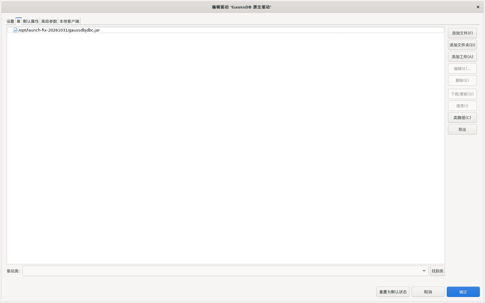

连接图 C03a：在“库”页使用右侧“添加文件”。左侧最终显示已添加的 gaussdbjdbc.jar；图中的本地目录仅为示例，客户使用自己保存官方 jar 的稳定目录。

5. 检查驱动类和 URL 协议。默认常用 `gsjdbc4.jar` 使用 `org.postgresql.Driver` 与 `jdbc:postgresql:`。若供应商 jar 实际使用 `com.huawei.gaussdb.jdbc.Driver`，则在高级驱动管理中配 `jdbc:gaussdb:`。按 jar 实际类名与协议配套，不因 O 库而强制换包；确认后返回连接主页。

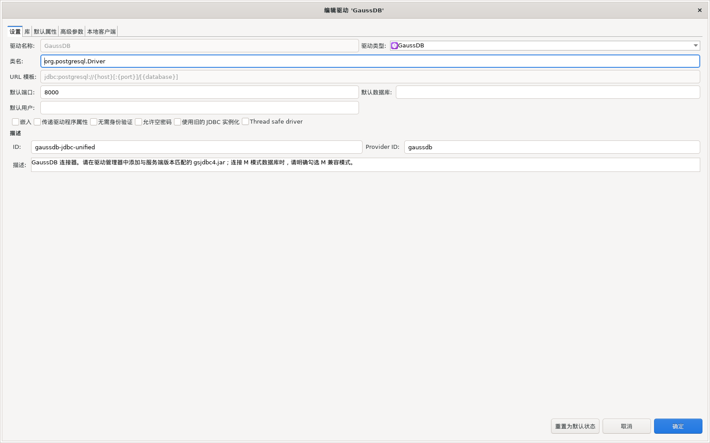

连接图 C03b：此历史截图展示 `com.huawei.gaussdb.jdbc.Driver` 与 `jdbc:gaussdb:` 的配套配置。新版默认 gsjdbc4 对应 `org.postgresql.Driver` 与 `jdbc:postgresql:`，不要只照抄图中类名；端口也以 DBA 提供值为准。

驱动定义可能由多个已有连接共用。已有正常连接时，修改前记录其库列表和使用范围；需要并行使用不同版本时，为连接准备独立的驱动定义后再调整，不直接替换所有连接共用的 jar。

#### T01.3 填写连接字段及密码保存选项

在“主要”页选择“主机”，填写 DBA 提供的信息；URL 随字段自动生成。O/A/ORA 库不勾 **M 兼容库**；M 库勾选后显式启用 `mCompatible=true`、`yearIsDateType=true`。这是本连接的 JDBC 参数，不会修改数据库模式。截图中的地址、端口、库名和用户仅为演示，使用自己的实际值。

| 字段 | 填写方法 |
| --- | --- |
| 主机/Host | 数据库服务地址或 DNS 名称；分布式填写 DBA 提供的 CN/统一服务入口，不以 DN 直连代替完整集群连接 |
| 端口/Port | 数据库服务监听端口；不要填 SSH 端口，也不要直接照抄截图中的演示端口 |
| 数据库/Database | 已存在且允许账号连接的数据库名，不是 schema 名 |
| 用户名/User | 数据库账号，不是麒麟系统或桌面云登录账号 |
| 密码/Password | 对应该数据库账号的密码；注意大小写和输入法，保持密码掩码显示 |
| 保存密码/Save password | 按企业安全策略决定是否勾选；不保存时，后续连接按提示重新输入。保存密码不是修改数据库密码 |

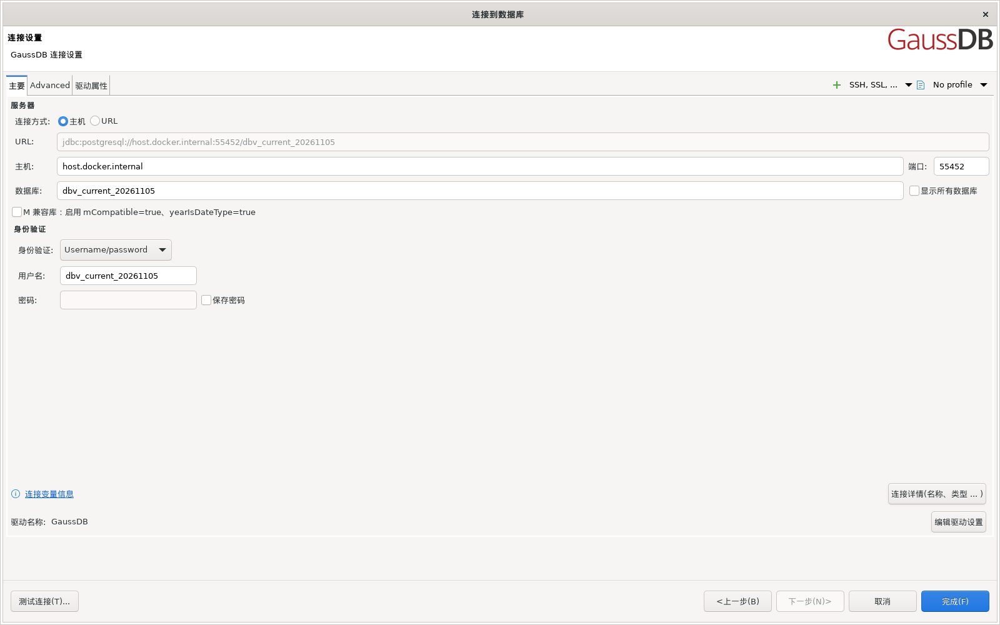

连接图 C04a：在“主要”页填写主机、端口、数据库、用户名和密码。示例未勾选“保存密码”；左下为“测试连接”，右下为“完成”及“编辑驱动设置”等入口。

如果 DBA 要求 SSL/TLS，请先在连接的 SSL 设置中按要求配置模式、CA 或客户端证书，再测试连接。不能因为演示截图未展开 SSL 页，就推断客户环境不需要 SSL；遇到证书错误时也不要直接关闭校验来取得“成功”。其他高级参数保持原配置，除非 DBA 提供了明确要求。

#### T01.4 测试连接并完成向导

1. 点击连接主页的 **测试连接/Test Connection**，等待结果。测试或展开连接时若出现“身份验证”窗口，输入数据库账号和密码，再点“确定”；未保存密码时，再次提示输入属于正常流程。

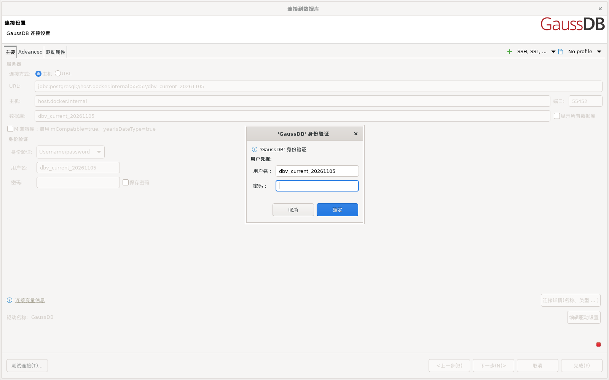

连接图 C04b：未保存密码时可能出现此身份验证窗口。输入数据库凭据后点“确定”，不要填写桌面云登录账号；密码保持掩码。

2. 成功对话框应显示“已连接”、服务器信息和驱动名称。核对后点击“确定”关闭结果框；服务器内核完整版本以后面的 `SELECT version()` 结果为准。若驱动版本文字无法识别，记录原文并核对官方 jar 的版本说明，不把该文本当作客户端版本。测试失败时，先按本节末尾排查，不把“已经创建配置”当作“数据库连接成功”。

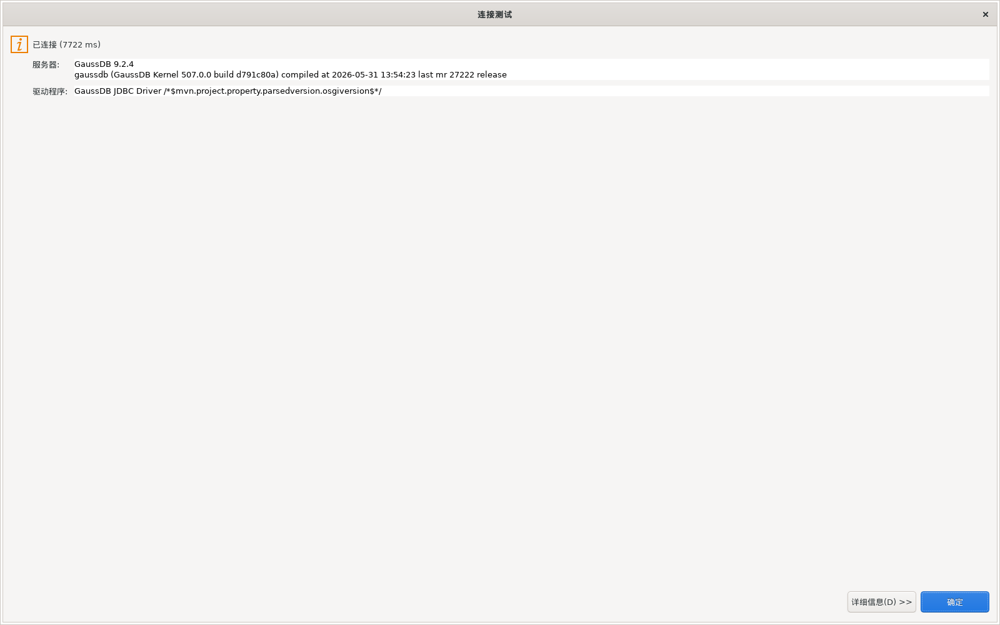

连接图 C05：“已连接”表示本次测试成功。服务器完整版本还应通过 SQL 查询确认；驱动版本如不能识别，保留原文并核对官方 jar 信息。关闭此窗口后还需点击连接向导的“完成”。

3. 点击 **完成/Finish** 保存连接。若随后再次提示输入密码，按刚才的密码保存选择处理；不要为消除提示而更改服务器认证。 如需设置便于识别的连接显示名，可用主页右下的“连接详情（名称、类型…）”；本例显示名为“GaussDB O 模式演示”，显示名不会改变数据库的兼容模式。
4. 在数据库导航器展开刚创建的连接 → 数据库（如显示）→ 模式/Schemas → 目标 schema。若能连接但看不到对象，先核对数据库、schema、权限和导航过滤器；空列表不一定表示数据库没有对象。

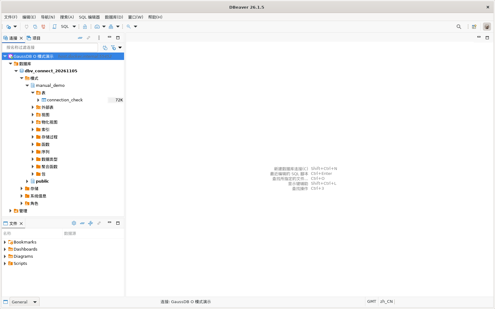

连接图 C06：已完成并展开演示连接，定位到数据库 dbv_connect_20261105 → 模式 → manual_demo → 表 → connection_check。客户应展开自己的目标库与 schema。

#### T01.5 打开 SQL 编辑器核对实际目标

1. 在数据库导航器中**右键刚创建的连接**，选择 **SQL 编辑器 → 新建 SQL 编辑器**。

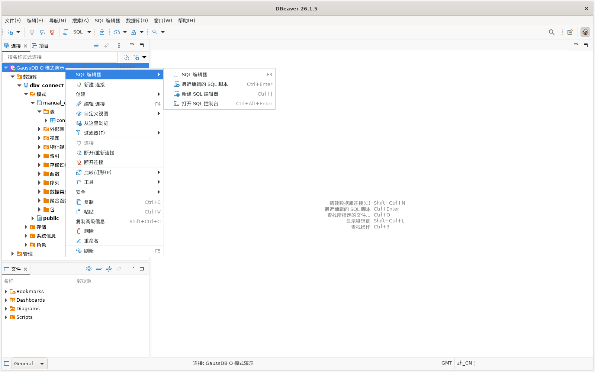

连接图 C07：右键连接，进入“SQL 编辑器”子菜单，点击“新建 SQL 编辑器”。不要误选只会打开已有编辑器的其他条目。

2. 确认编辑器顶部绑定的是该连接和目标数据库，再逐条执行以下查询。每次把光标放在待执行语句中，使用菜单 **执行 SQL 语句** 或界面显示的对应快捷键，不把三个结果混成同一项检查。

```sql
SELECT version() AS server_version;
SELECT current_database() AS database_name, current_user AS user_name;
SELECT name, setting FROM pg_settings WHERE name = 'sql_compatibility';
```

3. 在下方结果页分别记录服务器完整版本、当前数据库、当前用户和 `sql_compatibility`。O 模式名称在不同版本可能呈现为 O/A/ORA，不凭连接显示名称中的“Oracle”判断。

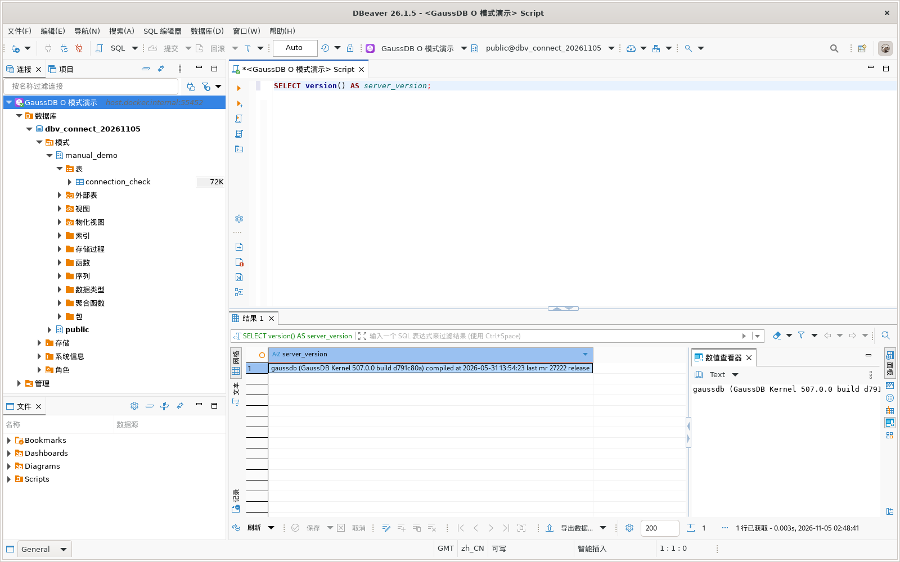

连接图 C08a：版本查询得到完整 GaussDB Kernel 507.0.0 信息，结果位于下方表格；需要时选中单元格，在右侧数值查看器阅读完整文本。

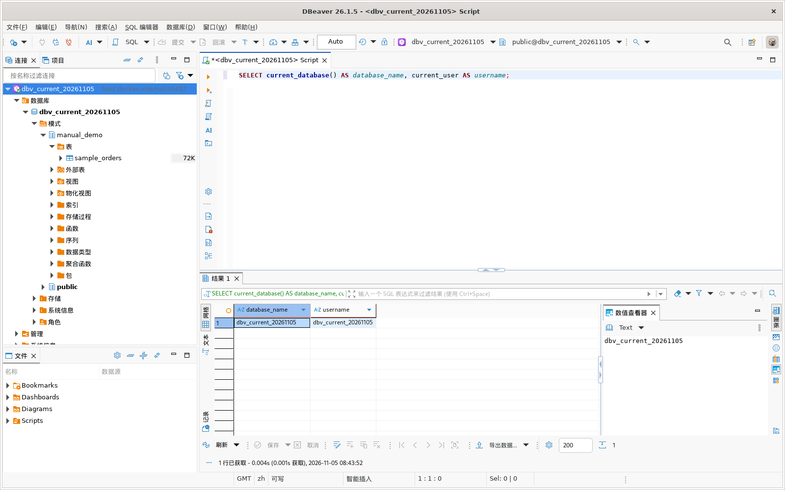

连接图 C08b：数据库名与当前用户分别显示在 database_name、user_name 列。示例二者同名，实际环境不要求相同，须分别核对。

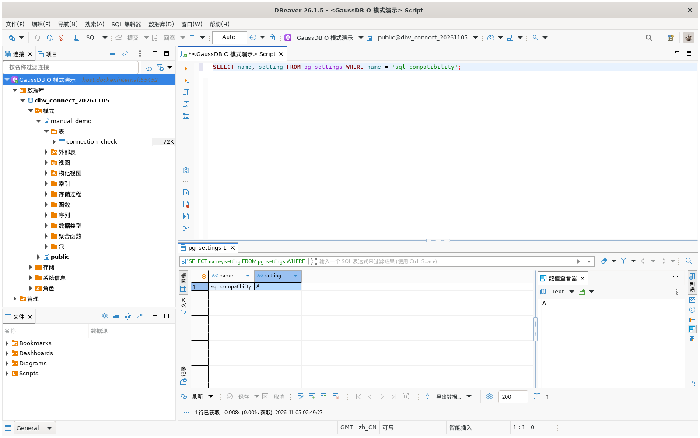

连接图 C08c：sql_compatibility 的 setting 返回 A，表示本演示库处于 Oracle 兼容模式；以实际查询值和 DBA 确认为准。

4. 如果查询失败或兼容模式没有返回结果，保留原始错误和结果，请 DBA 核对目标版本与模式。连接测试成功只证明本次连接建立成功，不等于已经具备 PL/SQL 调试角色、Package 权限或全部对象访问权限。

预期：连接配置保存成功；能展开目标 schema；SQL 查询得到的数据库、用户和模式与 DBA 提供的信息一致。后续所有调试与 Package 操作都继续使用这条已经核对的 O 模式连接。

#### T01.6 连接失败和日志收集

| 现象 | 先检查什么 |
| --- | --- |
| 找不到驱动类、Driver class not found | 是否选择 GaussDB；jar 是否存在、可读；实际驱动类与 URL 协议是否配套；是否混入多个冲突版本 |
| 连接被拒绝、超时、无法解析主机 | 主机、数据库端口、桌面到数据库的网络路径、DNS 和服务入口是否正确；请 DBA 或网络维护人员核对服务及访问规则 |
| 用户名或密码错误、认证失败 | 数据库账号、密码、数据库名及服务器允许的认证方式；不要用授予超级用户或关闭认证替代排查 |
| SSL、证书或主机名校验错误 | DBA 要求的 SSL 模式、证书文件、证书有效期和连接主机名是否匹配；保留原文，不直接关闭证书校验 |
| 测试成功但导航树没有对象 | 当前数据库、schema、账号对象权限、导航过滤器及刷新状态 |
| 目标数据库或兼容模式与预期不符 | 连接主页数据库字段和 SQL 编辑器顶部连接是否正确；以 SQL 查询结果为准，不以配置名称为准 |

发生错误时，展开错误对话框的 **详细信息/Details**，保留完整错误、SQLSTATE（若有）、发生时间、客户端构建、数据库版本和 JDBC 版本。不要只截取第一行“连接失败”。密码、私钥和完整证书内容不应放进截图或日志说明。

需要进一步排查时，在 **窗口 → 显示视图 → 其他** 中搜索 **错误日志/Error Log**，打开后选中对应时间的记录，查看并复制详细信息。日志用于保留客户端异常，不等于数据库服务器审计日志；服务器端认证或网络原因仍需 DBA 配合确认。

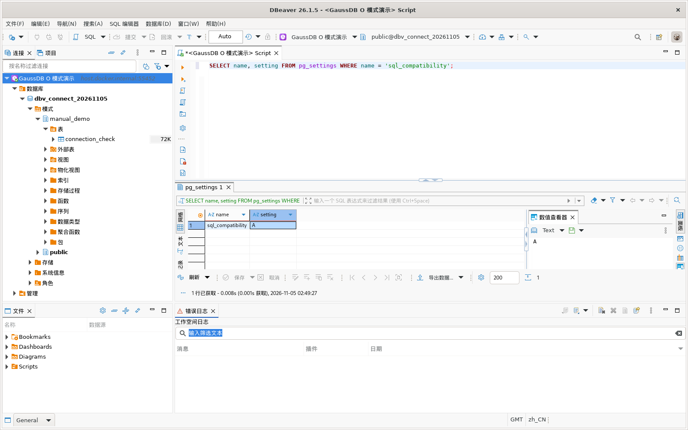

连接图 C09：底部“错误日志”窗格用于查看工作空间异常。本图当前没有错误记录，仅示意窗格位置；故障时按发生时间选择对应记录，查看详细信息。

### T02：M 模式基础能力

另从统一 **GaussDB** 入口新建连接，指向 DBA 提供的 M 库并勾选 **M 兼容库：mCompatible=true、yearIsDateType=true**。按官方 jar 实际类名配协议；同包可用于其支持的 A/O 与 M 库。此项只设置本连接的 JDBC 参数，不更改数据库模式。不要更改原 O 库。

1. 展开 schema、表、字段；双击测试表，查看“属性”和“数据”。
2. 在独立测试 schema 中创建普通表，插入、查询、修改、删除一条测试记录。逐条执行，并明确提交事务。
3. 在“数据”页刷新，确认结果与 SQL 查询一致；也可在数据网格改值并点击“保存”，检查实际数据。
4. 断开后重连，复查对象与数据。

预期：基础开发工作流可用。M 库 PL/SQL 调试和包功能应受限，此限制不是未完成的调试用例。不要把不可用项填写为“调试通过”。

### T16：查看分区表与二级分区

1. 在导航树展开 **连接 → 数据库 → 模式 → 目标 Schema → 表**，双击分区表。
2. 进入 **属性** 页，上方“分区依据”显示策略与真实列名，例如 `RANGE (id)`；下方左侧选择 **分区**，查看分区名称、分区表达式与边界。
3. 对二级分区表，在导航树继续展开 **表名 → 分区 → 一级分区 → 子分区**。双击一级分区时，右侧属性页显示其对子表的分区策略，例如 `LIST (region)`；左侧 **子分区** 列表显示下一层名称和边界。
4. 叶子分区没有下一级“子分区”入口。表格较窄时可关闭右侧 Chat 等视图，或横向滚动查看“分区表达式”列。
5. 数据库中新增或删除分区后，选中对应的父分区按 **F5** 刷新，确认导航树和已打开的子分区列表同步更新；无需重新创建连接。

下图来自麒麟 V10 x86_64 容器的实际客户端：

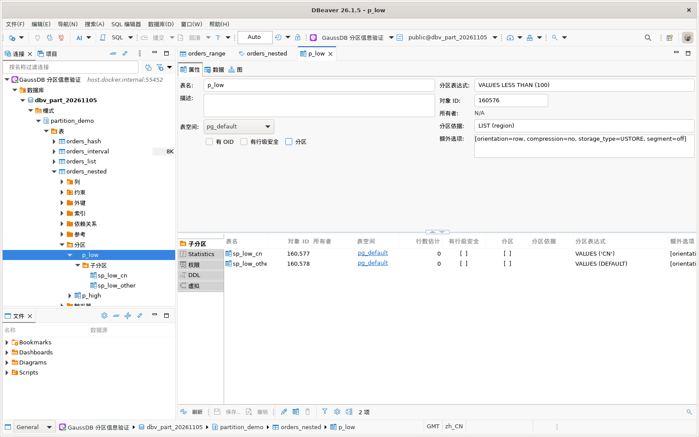

同一数据库在麒麟 V10 ARM64 容器的实际客户端：

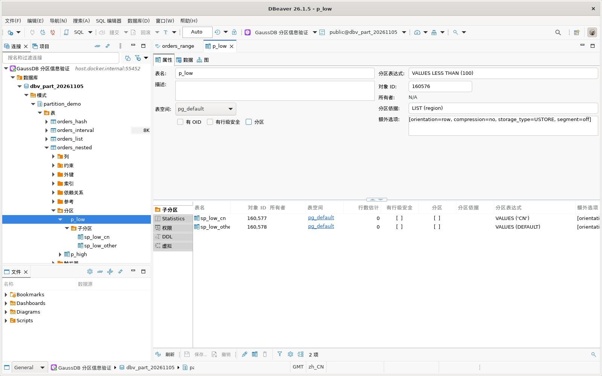

R3 本轮验证覆盖 RANGE、LIST、HASH、INTERVAL、带引号的分区列名、普通表与两级分区；保持原连接，新增后 F5 从两项变三项、删除后 F5 恢复两项，两个架构均通过。数据库为 GaussDB 507 集中式 ORA。x86_64 容器通过指令转译运行，两种容器均共享宿主 Linux 内核；这些结果不等于目标物理机或桌面云的最终验收，也不表示全部调试回归用例均在 ARM 上重跑。

## 4. 准备一个可重复调试的最小例子（T03）

以下例子使用已验证的父/子过程逻辑。**只在新建的、专用 O 模式验证库执行。** 如库中已有 `ui_acceptance` 或同名对象，停止，换新的测试库；不要覆盖现有对象。

1. 打开该 O 库的新 SQL 脚本。
2. 先分别执行以下两条 DDL。任何一条失败就停止，不要继续覆盖过程：

```sql
CREATE SCHEMA ui_acceptance;
CREATE TABLE ui_acceptance.ui_audit(value integer);
```

3. 再粘贴以下两段过程定义，通过 **SQL 编辑器 → 执行 SQL 脚本** 执行完整脚本。Linux/Windows 默认常用快捷键是 Alt+X；以菜单显示为准。不要只选中 BEGIN 中的几行执行。`/` 独占一行，作为块结束分隔，不单独发送给数据库。

```sql
CREATE OR REPLACE PROCEDURE ui_acceptance.ui_child(p_in int)
AS
DECLARE v_child int;
BEGIN
  v_child := p_in + 2;
  INSERT INTO ui_acceptance.ui_audit VALUES(v_child);
END;
/

CREATE OR REPLACE PROCEDURE ui_acceptance.ui_parent(p_in int)
AS
DECLARE v_local int;
BEGIN
  v_local := p_in + 1;
  ui_acceptance.ui_child(v_local);
  INSERT INTO ui_acceptance.ui_audit VALUES(v_local);
END;
/
```

4. 如果 SQL 编辑器处于手动提交模式，提交准备阶段的事务。右键导航树的连接/schema →“刷新”，展开 `ui_acceptance → 存储过程`，应看到 `ui_parent` 和 `ui_child`。
5. 双击两个对象，分别打开它们的源码页，后续断点在这些对象源码页设置。

预期：对象创建成功且可从导航树打开。不要以“普通 SQL 编辑器里能看到过程文本”代替对象实际存在。

### 普通存储过程源码修改与保存

调试暂停时打开的正文用于查看当前执行位置，不支持在暂停状态热替换正在执行的代码。要修改定义，请先结束本轮调试并处理剩余事务，再关闭调试中打开的正文页。

1. 在左侧 **数据库导航器** 展开 **连接 → 数据库（如显示）→ 模式/Schemas → 目标 schema → 存储过程/Procedures**。
2. **双击具体过程**，在打开的对象编辑器中进入 **属性/Properties**，点击左下方的 **源/Source**。
3. 源码区应显示该对象完整的 `CREATE OR REPLACE PROCEDURE ...` 定义。修改源码，按 **Ctrl+S**，检查待执行的保存 SQL 后确认；保存成功后刷新或重新打开，确认数据库中定义已更新。
4. 若要验证修改后的行为，重新启动调试。保存失败时保留数据库错误，修正源码后再保存，不把编辑器里的未保存文本当作已编译定义。

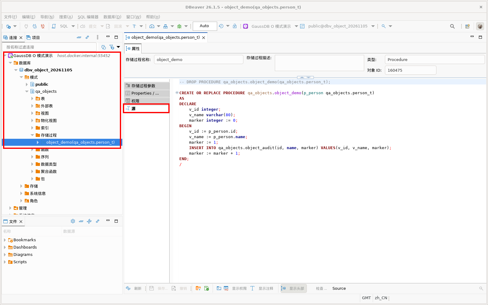

普通源码入口图：左侧红框标出导航树中的具体过程，右侧红框标出“源”。图中 `qa_objects.object_demo` 是演示对象，使用时替换为实际 schema 和过程名。修改源码的保存操作与调试结束时的剩余数据事务处理是两件事。

## 5. 新建调试配置并启动（T04）

先完成第 1 节启用功能的步骤，并激活 `ui_parent` 对象源码页。

1. 打开“数据库调试”配置窗口；选择 Database Debug 类型，新建配置，名字填写 `示例-ui_parent-10`。
2. 在连接/数据源下拉框中选刚才的 O 模式 GaussDB 连接。不要误选 M 库或另一个同名连接。
3. 在调试类型中选 **GaussDB routine**。
4. 点击 **Routine** 选择框右侧下拉按钮，在对象选择窗口展开 `ui_acceptance → 存储过程`，选择 `ui_parent` 并确认。
5. 下方 **Input parameters** 参数表显示 `p_in`。双击 **Value** 单元格，填 `10`，再点其他单元格让输入保存。
6. “输入方式”使用 **输入值**；`10` 是数值文本，不加引号。要传数据库空值时选择 **SQL NULL**，不能用输入字符串 `NULL` 代替。使用默认值仅用于服务端确实有默认值的连续末尾参数，本例不选。
7. 点“应用/Apply”（如显示），再点 **Debug/调试**。若提示打开调试透视图，确认。
8. 等待调试处于暂停状态、源码当前执行行高亮，再操作单步或变量。启动失败时保留完整错误，不反复点 Debug 创建更多会话。

预期：启动的是指定库、指定 schema 的父过程，输入值为 10。当前行通常表示下一条将要执行的语句，所以赋值执行前变量可以为空，不能误判为变量读取失败。

重复启动：通过调试图标下拉选择 `示例-ui_parent-10`。修改参数或连接时重新打开配置，不能假设当前 SQL 编辑器的连接会自动修改已有调试配置。

### 对象类型入参

本节使用显式 `CREATE TYPE ... AS (id integer, name varchar(80))` 定义的复合类型作为示例，例如 `qa_objects.person_t`，对应过程参数是 `p_person qa_objects.person_t`。请先由数据库中的实际定义确认字段顺序和类型；图中 `qa_objects.object_demo` 需替换为实际过程。

1. 在调试配置中选中该过程，确认 Input parameters 中显示 `p_person` 及其实际类型。
2. “输入方式”选择 **输入值**，在 Value **一个单元格中填写完整复合值**：`(1,张三)`。括号和逗号属于复合类型文本格式，不在外层再加 SQL 单引号，也不填整条 `CALL`、`ROW(...)` 或强制类型转换 SQL。
3. 如果字符串字段本身含逗号，使用双引号包围该字段，例如 `(2,"Alice, Jr.")`。字段位置必须与类型定义一致。要传入数据库空值，将“输入方式”改为 **SQL NULL**，不要用字符串 `NULL` 代替。
4. 点击其他单元格保存输入，再启动调试。暂停并执行字段赋值后，检查过程接收变量；示例中 `v_id` 和 `v_name` 分别用于确认 id 与 name。对象变量本身的文本展示由服务端返回，不能只凭其外观判断字段已正确接收。
5. 按 F9 执行完成，处理剩余事务，再用独立连接查询示例过程写入的数据，核对字段值和 SQL NULL 的实际结果。

GaussDB 507 的 `info_locals` 在整个复合对象为 SQL NULL 时，字段摘要可能显示数值 `0` 或字符 `<UNKNOWN>`。不要把这些调试展示当作实际业务值；本轮 SQL NULL 场景通过独立连接的 `id IS NULL`、`name IS NULL` 查询确认了实际入库结果。普通值和含逗号文本同时核对暂停时的接收变量及提交后的独立查询结果。

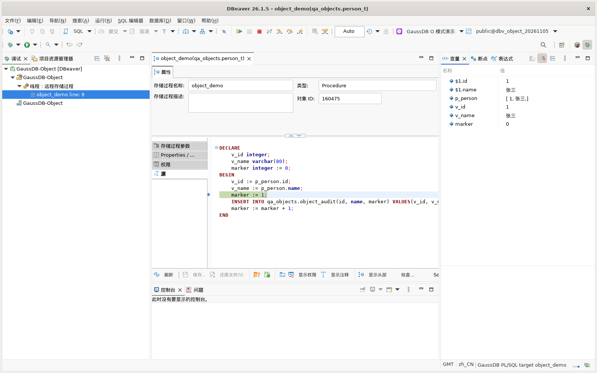

对象入参示例图：`(1,张三)` 进入过程后，变量窗格显示 `v_id=1`、`v_name=张三`。这是显式复合类型的整段文本输入；当前参数窗格没有逐字段对象编辑表单。匿名 record、任意对象、嵌套复合类型、数组以及 JSON/JSONB 的编辑体验不属于本节验证结论，不能直接套用这两个字段的示例。

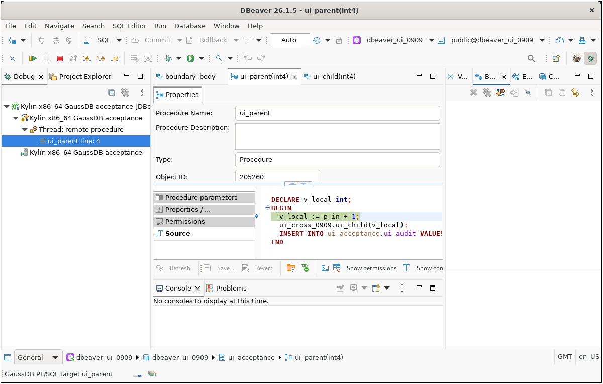

图 1：左侧 Debug 树显示暂停栈帧；中间 Source 页显示过程源码，箭头及高亮标识当前执行位置。顶部 Database 对应“数据库”菜单。图示为跨 schema 演示过程，调用对象与第 4 节最小示例不同。

## 6. 打开调试所需的四个窗口

在 **窗口（Window）→ 显示视图（Show View）→ 其他（Other）** 中搜索或展开 Debug 类别，打开：

| 窗口名称 | 用途 |
| --- | --- |
| Debug / 调试 | 展开会话、线程、栈帧，查看父子调用关系；工具栏进行步进/继续/终止 |
| Breakpoints / 断点 | 集中查看断点，勾选启用、取消勾选禁用、删除 |
| Variables / 变量 | 当前选中栈帧的变量名和值；可修改的变量允许改值 |
| Expressions / 表达式 | 添加监视变量；支持变量名和已返回的游标状态属性，不是任意 SQL 或算术表达式求值器 |

若窗格为空，先在 Debug 树中选中一个**暂停中的栈帧**，不要只选最外层连接/进程。不同语言包可能仍显示英文视图名称。

## 7. 断点及五个执行控制动作（T05、T06）

### T05：断点设置、禁用、启用、删除

1. 在 `ui_parent` 对象源码中，找到 `ui_acceptance.ui_child(v_local);` 这一行。
2. 双击该行最左侧的灰色标尺区域（不是正文），应出现断点标记；或右键标尺 →“切换断点”。不要在注释、空行、CREATE 头上测试断点。
3. 在 `ui_child` 的 `INSERT INTO ...` 行也设置断点。Breakpoints 窗格应列出相应对象及行号。
4. 启动或重新运行父过程，点击“继续”，验证停在启用的断点行。
5. 在 Breakpoints 中取消子过程断点的复选框，再运行一次：该断点不应导致停住。不能用 F7 的单步暂停证明禁用失败。
6. 再勾选该断点，下一次运行应重新命中。重复“取消勾选→勾选”两轮，不应出现 invalid break point index/already enabled。
7. 选中某个断点，右键 Remove/删除，或在源码同一标尺处再次双击；窗格条目消失。重新添加、再运行，应仍可命中。

每轮结束选择回滚，避免累积测试数据。断点会保存在工作区中，结束调试或关闭源码后仍可能显示；它们是已设置的断点，不是执行历史。只操作本例断点，不用“删除所有断点”清除其他工作配置。升级旧工作区后无法命中的旧断点，删除该测试断点并在正确数据库对象上重建。

### T06：执行控制

先用工具栏按钮测试功能，再独立测试快捷键。鼠标悬停图标可见动作名称；不要只凭图标形状猜测。

| 功能 | 点击/按键 | 本例怎么测 | 应看到什么 |
| --- | --- | --- | --- |
| 单步进入 | Step Into，F7 | 父过程停在调用 `ui_child` 的行时执行 | 进入子过程源码，调用栈新增子帧 |
| 单步跳过 | Step Over，F8 | 另一次运行停在父过程调用行时执行 | 执行子调用后回到父过程下一行，不按单步进入展开子过程；启用的子断点仍可能截停，测跳过时先禁用子断点 |
| 单步退出 | Step Return，Shift+F7 | 已在子过程暂停时执行 | 返回父过程；若途中有启用断点，可能先命中它 |
| 继续 | Resume，F9 | 暂停时执行 | 运行到下一个断点或结束并进入事务收尾 |
| 终止 | Terminate，F10 | 单独一轮暂停时执行 | 会话终止，之后可重新调试；独立查库确认未产生本轮未提交数据 |

桌面云、Fn 功能键、输入法可能拦截 F7/F8/F9/F10。按钮有效而快捷键无效时，分别记录；不能把按钮通过写成快捷键通过。快捷键测试时让调试窗口获得焦点。

## 8. 变量查看、修改、监视和调用栈（T07～T09）

### T07：查看与修改变量

1. 父过程执行完 `v_local := p_in + 1;`，停在调用子过程行时，选中父栈帧。
2. Variables 中应能看到 `p_in=10`、`v_local=11`。在赋值执行前看不到 11 属正常现象。
3. 右键 `v_local` → **Change Value/更改值**（或在可编辑的值单元格双击），输入 `20` 并确认。
4. 检查变量读回为 20，再 F7 进入子过程，子过程输入值应为 20；执行子过程赋值后 `v_child` 应为 22。
5. 本轮结束选择回滚。另开无改值的一轮测试后续标准数据，不把改值轮和标准轮混算。

负向测试：将整数变量输入非法文本，应提示失败，不得伪造为修改成功。常量、非当前可写帧等受保护对象可能拒绝修改，不承诺所有变量都能修改。

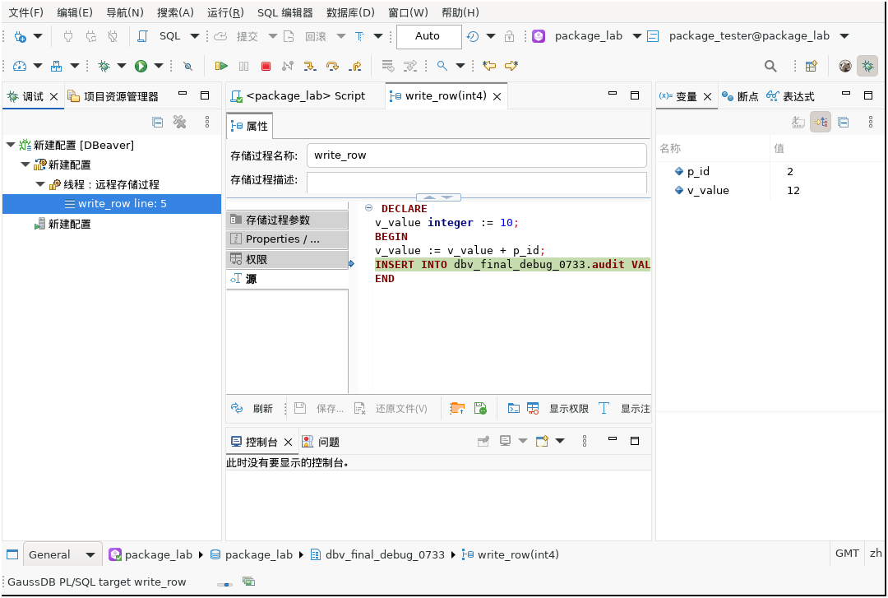

图 2：调试暂停后，左侧显示当前线程和栈帧，中间源码高亮当前执行行，右侧 Variables/变量窗格显示当前栈帧的参数和局部变量。截图已经裁去桌面空白区域，显示完整 DBeaver 窗口。

### T08：添加监视变量

1. 父过程暂停且父帧选中时，打开 Expressions。
2. 在窗口空白处右键 → **Add Watch Expression/添加监视表达式**，输入 `v_local`，确认。
3. 步进赋值后观察值变化；改成 20 后再次确认监视值。
4. 在子帧添加 `v_child`，查看该帧变量。切帧后不在作用域的变量可能不可用，这是作用域变化，不应显示其他帧的陈旧值。
5. 右键该监视项 → Remove/删除，验证移除。

支持 `v_local` 这种变量名，以及下文列出的游标状态属性；不支持 `v_local + 1`、任意函数调用或 SELECT 表达式。

### 游标状态查看与监视

适用于服务端 `DBE_PLDEBUGGER.info_locals(frame_id)` 已返回状态的 `refcursor` / `sys_refcursor` 变量。无需增加会话参数。

1. 在包含游标的过程或包内成员中启动调试，暂停后，在 Debug/调试窗格选择目标栈帧，再打开 Variables/变量窗格。
2. 找到游标变量，例如 `cur`。值列显示类似 `(ROWCOUNT=1, ISOPEN=true, FOUND=true, NOTFOUND=false)` 的状态摘要；展开变量，可分别查看 `%ISOPEN`、`%FOUND`、`%NOTFOUND`、`%ROWCOUNT`，有实际游标名称时还显示 `NAME`。
3. 在 Expressions/表达式中添加 `cur`，可展开查看其属性；也可只监视 `cur%ROWCOUNT` 或 `cur%ISOPEN`。游标变量名须与 Variables 中一致，属性名不区分大小写。同一帧存在多个同名变量时，属性监视会提示歧义，请直接展开相应变量查看。
4. 用 F8 执行业务代码原有的 `OPEN`、`FETCH`、`CLOSE`，每次再次暂停后检查状态刷新。切换栈帧时，只显示所选帧的游标状态。服务器未返回的属性保持未知，不推断为 false 或 0；无法可靠解析的值保留服务端原文。

| 属性 | 含义 |
| --- | --- |
| `%ISOPEN` | 服务端报告游标是否打开 |
| `%FOUND` / `%NOTFOUND` | 服务端报告上次 FETCH 的状态；两者都为 false 时不要推断已经取尽，刚打开尚未 FETCH 也可能如此 |
| `%ROWCOUNT` | 服务端报告的行计数，不代表查询总行数或剩余行数 |
| `NAME` | 服务端返回的实际游标名称，不是结果行 |

游标及其属性只读；查看、展开和添加监视不会执行 `FETCH`，也不会推进游标。当前窗口**不展示游标结果行、列结构或原查询 SQL**。如需检查业务代码已 FETCH 的当前行，请在 `FETCH ... INTO ...` 后暂停，查看接收变量。完整结果集的无损预览仍依赖服务端新增能力。

### T09：调用栈及双击源码导航

1. F7 进入子过程后，在 Debug 树展开会话/线程，应看到 `ui_child` 和 `ui_parent` 的栈帧。
2. 双击父帧，应切到父过程源码及调用位置；双击子帧，应切回子过程当前执行行。
3. 检查对象 schema、名称、行高亮，不只检查标签页打开了。
4. 可使用仓库的 `cross-schema-gaussdb.sql` 在另一个专用测试库扩展跨 schema 同名对象测试，先完整阅读脚本，不在共享业务 schema 上直接执行。

行号以服务端返回的源码和编辑器实际显示为准，不硬套手册代码块的排版行号。主动关闭源码标签后，界面不应因旧的导航请求立即重新打开或抢回焦点；需要查看时可再次双击对应栈帧。

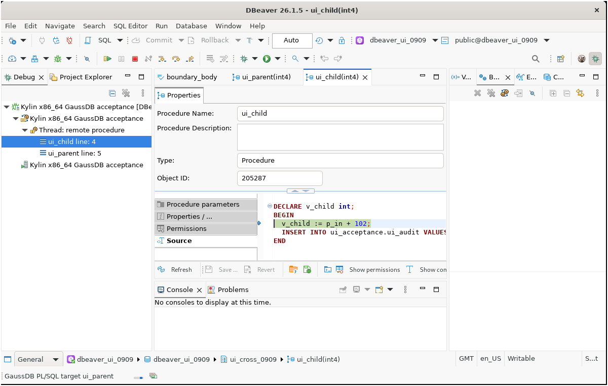

图 3：左侧同时显示 ui_child 和 ui_parent 栈帧，双击对应帧切换源码。图中子过程的计算常量为跨 schema 演示值，不应用来判断第 4 节示例的 11/13 结果。

## 9. 调试完成提交或回滚（T10、T11）

最外层调用全部执行完毕后，调试进入剩余事务处理阶段，此时“继续（F9）”和各单步按钮应置灰。窗口标题为“结束调试：处理剩余事务”，按钮是“提交剩余事务并结束”和“回滚剩余事务并结束”；默认选中回滚。处理后，再用独立连接检查数据结果。

如果只是内层过程或函数返回上层，调用栈中仍有暂停的上层帧，而且整个调用尚未完成，则仍可继续或单步执行上层逻辑；返回上层不等于整个调试已经结束。

**不能只看到弹窗就判定事务测试通过。必须用另一条独立连接查数据。** 新建第二个同库连接，命名为“验证查询”，用自动提交查询，避免旧事务快照影响结果。

基线查询：

```sql
SELECT value, COUNT(*) AS n
FROM ui_acceptance.ui_audit
GROUP BY value ORDER BY value;
```

### T10：正常完成后提交

1. 记录基线。使用参数 10、没有改变量的一轮，F9 执行完全部代码；如遇断点就继续，直到过程完成。
2. 出现“结束调试：处理剩余事务”窗口时，确认本轮需要保留剩余未提交数据，点击 **提交剩余事务并结束**。
3. 在“验证查询”连接重新执行查询。
4. 预期：相对基线，值 11 和 13 各多一条，合计多 2 条。表中显示排序后的 11、13，不等于真实插入顺序。

### T11：正常完成后回滚、终止

1. 重新记录基线，再运行同样过程，结束时点击 **回滚剩余事务并结束**。
2. 用查数连接查询，预期与本轮基线完全一致。
3. 单独一轮在暂停中按 F10，终止后独立查库，再重新启动调试，确认数据和会话均正常。

如果提交/回滚提示失败或结果未知，保留错误，请 DBA 配合独立查证；不要自动重试提交。

### 过程内部已有 COMMIT 时如何判断结果

该窗口只处理**调试连接中仍未提交的剩余事务**。过程或被调用对象已经执行 `COMMIT` 的内容，最后再选择回滚也无法撤销；源码编辑器中通过 Ctrl+S 保存定义的操作，也不由这个窗口撤销。自治事务和外部调用的副作用应另行核查。

例如过程先插入 `901`、执行 `COMMIT`，再插入 `902`：结束前，调试连接可看到两行，独立连接只能看到已提交的 `901`；选择“回滚剩余事务并结束”后，`902` 被回滚，`901` 仍然存在。本轮已在通过转译运行的麒麟 V10 x86_64 容器连接 GaussDB 507 ORA 真库，完成 DBeaver 图形界面及 JDBC 调试链路验证；GUI 选择回滚前后，独立连接查询均为 `901` 一行、`902` 零行。

客户端不能自动识别本次过程执行过哪些历史 `COMMIT`。即使过程最后一行是 `COMMIT`，驱动随后仍可能报告事务为 `OPEN`，因此仍可能出现剩余事务处理窗口；不能用弹窗是否出现判断过程有没有提交。以上 `ui_parent`/`ui_child` 最小例子不含内部 `COMMIT`，其 T10/T11 预期只适用于这份示例。

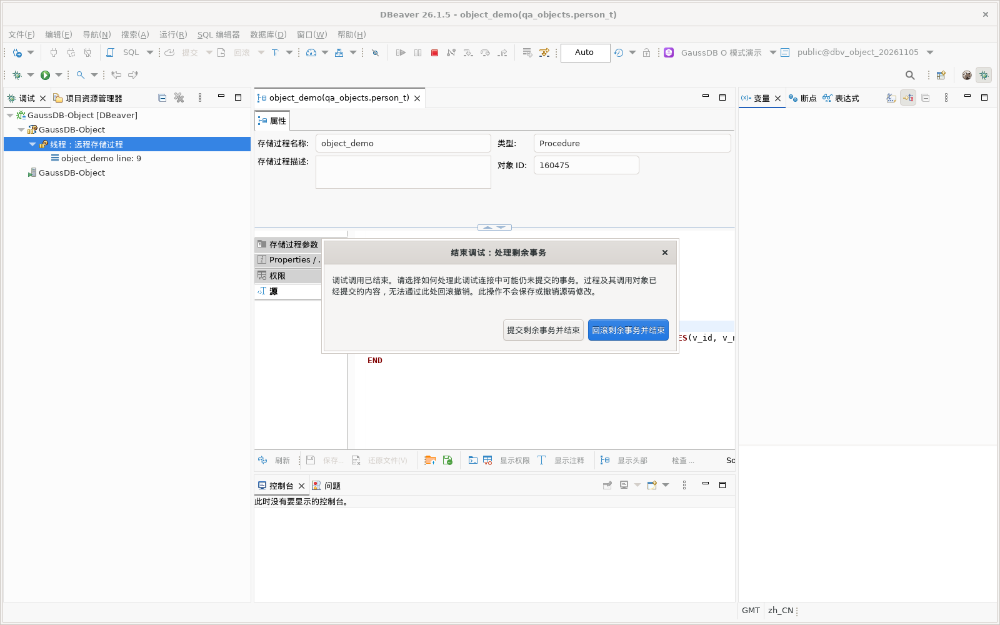

图 4：调试结束时只处理调试连接仍未提交的剩余事务，默认回滚；已被过程或调用对象 COMMIT 的内容无法撤销。选择后必须由独立连接查数。

## 10. Package 创建、编译、错误定位、批量删除（T12～T15）

### T12：准备并创建有效包

前提：O/A/ORA 兼容模式专用测试库提供 `gs_package`；`ui_pkg` schema 和以下包名均不存在。部署形态不是单独的判定条件，应以实际能力探测结果为准。先单独执行 `CREATE SCHEMA ui_pkg;`，成功后再执行下面完整脚本。

```sql
CREATE PACKAGE ui_pkg.manual_pkg AS
  FUNCTION value_of RETURN INTEGER;
END manual_pkg;
/
CREATE PACKAGE BODY ui_pkg.manual_pkg AS
  FUNCTION value_of RETURN INTEGER AS
  BEGIN
    RETURN 42;
  END value_of;
END manual_pkg;
/
SELECT ui_pkg.manual_pkg.value_of();
```

预期返回 42。手动事务模式下提交准备阶段事务，刷新导航树：**连接 → 目标库 → schema `ui_pkg` → 包/Packages → manual_pkg**。

双击包对象，检查 **声明** 和 **主体** 两个标签。声明相当于接口，主体包含实现。

### Package 成员调试：必须确认本次会话设置

调试 Package 内的过程或函数时，配置页会单独显示本次必须执行的 SQL：

```sql
SET LOCAL search_path = <Package 所在 schema>
```

配置页会显示实际 schema、设置原因和影响范围，可勾选“我已了解，并允许仅为本次调试设置上述参数”。未勾选或使用工具栏再次启动时，启动确认框会列出连接、数据库、包内成员及本次 `SET LOCAL search_path`；核对后选择“是”才会启动，选择“否”或关闭确认框则不启动。确认仅对本次调试有效，不会形成长期授权；下次调试仍须再次确认。

该命令只在隔离的调试连接和当前事务内生效，提交或回滚后自动失效；不会执行持久的 `ALTER ROLE` / `ALTER DATABASE`，也不会改动用户正在使用的 SQL 编辑器会话。独立存储过程不需要此设置，不会出现该确认项。

### T13：编译全部、声明、主体

1. 在导航树中右键 **manual_pkg 包对象**，不是右键 Packages 文件夹。
2. 分别执行 **编译包**、**编译包声明**、**编译包主体**。每次等后台编译结束再做下一次。
3. 对应数据库动作是 `ALTER PACKAGE ... COMPILE`、`COMPILE SPECIFICATION`、`COMPILE BODY`，不是编译 Java，也不是重新打客户端包。
4. 如果源码页有未保存修改，先 Ctrl+S 并确认保存 SQL，再编译；出现“Save package”说明应先处理未保存内容。
5. 刷新包，重新执行函数查询，预期仍返回 42；无错误诊断不一定弹出专门的成功对话框。

客户端会先请求服务端原生编译。若目标部署不支持相应的 `ALTER PACKAGE ... COMPILE`，但提供 `GS_SOURCE`，客户端会读取服务器已保存的声明/主体源码，将其规范化为 `CREATE OR REPLACE` 后重放。重放是兼容路径，不会执行 `SET enable_force_create_obj`、`SET plsql_show_all_error` 或其他私有会话参数；界面也不会在后台静默修改这些参数。

批量编译：按住 Ctrl 选择本轮多个测试包，右键“编译包”。如果中途失败/取消，要记录已处理数量；不能把剩余未执行对象记为成功。

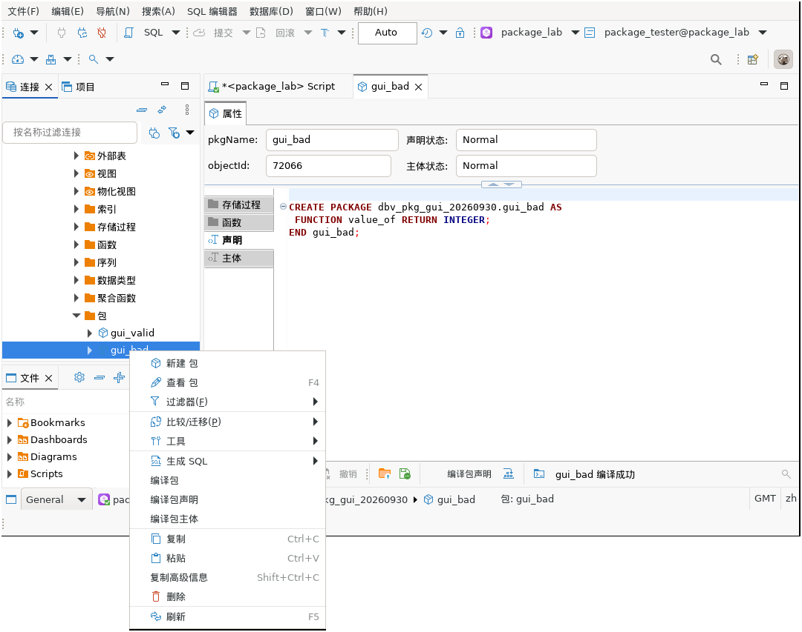

图 5：右键具体 Package 对象可看到“编译包、编译包声明、编译包主体”；不要在 Packages 文件夹或普通 SQL 编辑器标签上查找这些菜单。

### T14：错误列表及源码定位

1. 只操作 `manual_pkg` 的测试主体。将 `RETURN 42;` 改为 `RETURN manual_missing_symbol;`，保存。也可在 SQL 编辑器执行完整 `CREATE OR REPLACE PACKAGE BODY` 测试定义，保留全部结束分号。
2. 保存可能马上报错；先保留错误。某些服务端会拒绝并保留旧主体，这种情况下后续编译旧主体成功不能算错误定位通过。
3. 在导航树右键该包 →“编译包主体”。出现 **包编译错误** 窗口后，先根据下表判断诊断等级，再记录结果。
4. 双击诊断行，或选中后点 **打开源码**。结构化精确诊断应定位到服务端返回的实际行；源码重放的近似诊断只用于帮助查找错误标记，必须结合错误原文和源码复核。
5. 将错误改回 `RETURN 42;`，保存并重新编译，刷新后再查函数，应恢复 42，旧诊断不应继续冒充当前错误。

| 服务器能力 | 客户端行为 | 行号含义 |
| --- | --- | --- |
| 提供 `DBE_PLDEVELOPER.GS_ERRORS` | 使用服务端结构化编译诊断 | 精确行号；按实际返回的行、列和错误信息定位 |
| 不提供 `GS_ERRORS`，但提供 `GS_SOURCE` | 对已保存源码执行 `CREATE OR REPLACE` 重放并显示数据库直接错误 | 仅当错误中的标记能在原始源码中唯一可靠匹配时显示“近似”位置 |
| 直接错误无法可靠映射到唯一源码位置 | 仍显示数据库直接错误 | Line 显示 `-`，打开对应声明或主体，但不跳到虚构行号 |
| 不提供 `gs_package`，或既无结构化诊断也无可重放的已保存源码 | 相应能力不可用 | 记录服务端能力不足及错误原文 |

如果服务端直接拒绝保存无效主体，编辑器中未保存的错误文本不会被冒充为服务器已保存源码。应先保留保存失败的错误原文；只有 `GS_SOURCE` 中确实存在待编译源码时，源码重放才可继续。不能把“近似”位置记作服务端精确定位，也不要为造错误修改系统表或开启未获批准的私有参数。

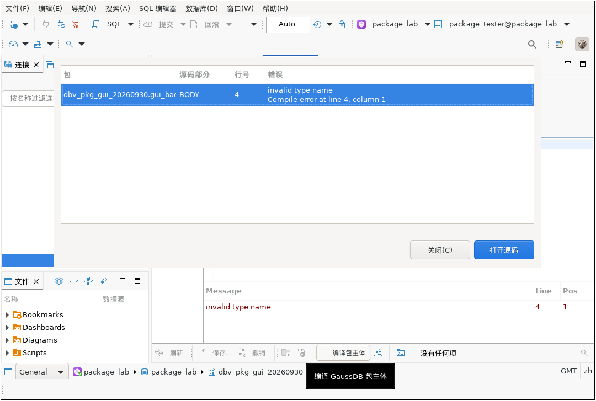

图 6：Package、Source part、Line、Error 分别对应“包、源码部分、行号、错误”；选中错误后点击右下角 Open source（打开源码），或双击错误行。实际错误内容由服务器返回。

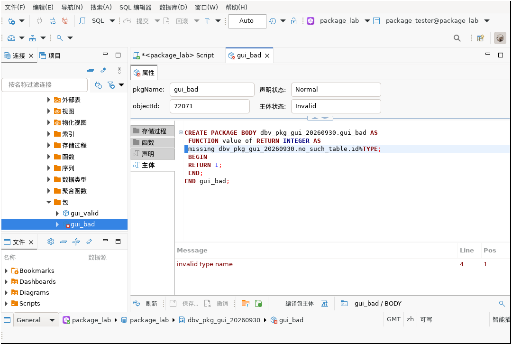

图 7：打开源码后，编辑器切换到发生错误的声明或主体；精确行号来自服务端结构化诊断，近似位置和 `Line -` 必须按第 14 步说明解释。

### T15：批量删除及取消

1. 在 SQL 编辑器另建仅有声明的第二个测试包：

```sql
CREATE PACKAGE ui_pkg.manual_pkg_second AS
  FUNCTION value_of RETURN INTEGER;
END manual_pkg_second;
/
```

2. 提交并刷新 Packages。按住 Ctrl 同时选择 `manual_pkg`、`manual_pkg_second`。
3. 右键 **删除/Delete**（或 Delete 键），检查确认框只有这两个测试包。第一次点“取消”，刷新确认二者仍在。
4. 第二次重复删除并确认；如显示 SQL 预览，核对只包含这两个包，不选择级联删除业务依赖。
5. 刷新导航树，并由另一连接确认目标 schema 中两个测试包均已不存在。不能只凭当前树节点消失判断成功。

删除无法靠“撤销文本编辑”恢复，只能依靠保存的 DDL 在测试库重建。不要选中整个 schema 或连接执行删除。

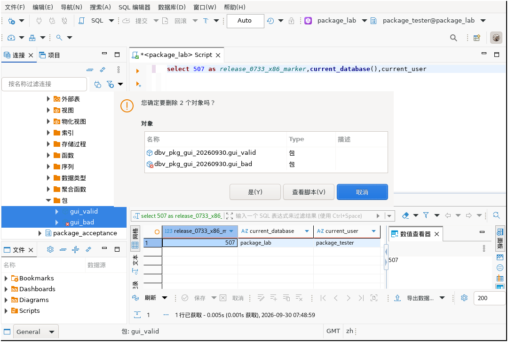

图 8：确认框必须只列出本次选中的测试包；第一次取消验证无副作用，第二次才确认删除。

## 11. 复杂语法扩展与测试收尾

复杂包脚本：`test/org.jkiss.dbeaver.ext.gaussdb.debug.test/integration/swtbot/complex-package-boundaries.sql`（可从发布页源码压缩包取得）。

只在专用 O 库、`ui_pkg` 下对应包名尚不存在时执行，选择“执行 SQL 脚本”。脚本覆盖嵌套局部函数、IF/ELSE、FOR 循环、初始化块、带 END/分号/斜杠的字符串和注释、带分号的引号对象名以及除法。

预期第一组查询为 `6`、`END; it's / text`、`3`，第二组为 `7`。脚本含异常处理结构，但正常返回成功不代表实际异常分支已被触发。

收尾：保存截图与测试结果；结束调试并处理事务；清除本轮断点和监视；仅删除确认属于自己的测试包、过程和表。不要执行 `DROP SCHEMA ... CASCADE` 清理可能共享的 schema。保留 DDL 以便复测。

## 12. 常见问题：先按现象定位

| 现象 | 先检查什么 | 不要做什么 |
| --- | --- | --- |
| 顶部没有数据库调试 | Help → Show Product Configuration → Procedure debugger；打开具体过程对象源码并激活 | 不要把普通 SQL 脚本当作调试对象 |
| 新建配置提示 No tab group defined | 关闭“运行配置”，改从“数据库 → 数据库调试”或小虫下拉“数据库调试配置”进入；核对当前构建并更新到本页版本 | 不要删除工作区；“运行配置”用于其他启动类型 |
| 功能已开仍无入口 | 当前连接是否 GaussDB、是否 O 库、过程语言是否可调试；产品功能是否限制数据库开发权限 | 不要在 M 库强开 PL 调试 |
| 配置无 GaussDB routine | 选中的数据源类型和四个 GaussDB 插件是否齐全 | 不要安装 PG 调试器代替 GaussDB 协议 |
| 找不到 Procedure debugger 配置向导 | Ctrl+3 搜索 Show Product Configuration；核对“关于”中的当前构建，并在安装详情中检查 GaussDB 调试插件状态 | 不要把缺失菜单直接归因于服务端权限 |
| Debug 按钮灰色 | 是否选好连接、Routine、必填参数；点开参数编辑框后有没有离开单元格保存；窗口警告是什么 | 不要连续点主工具栏启动上次配置 |
| Package 调试提示会话设置 | 核对配置页或启动确认框中的连接、数据库、包内成员和 `SET LOCAL search_path`；确认仅对本次有效，取消则不启动 | 不要把本次确认当作长期授权，也不要手工改成持久的 `ALTER ROLE` / `ALTER DATABASE` |
| 启动报权限/API 错误 | 记录完整错误和 SQLSTATE，DBA 检查角色、API 签名、目标语言及权限 | 不要默认改成超级用户或关闭认证 |
| 看不到变量/堆栈 | 是否实际暂停；Debug 树中是否选中栈帧；变量是否尚未赋值 | 不要把运行中的空窗格当作读取失败 |
| F7 等不生效 | 先试对应按钮，再查桌面云键盘映射、Fn 和窗口焦点 | 不要把按钮成功记为快捷键通过 |
| 单步至结尾后再继续报 `not suspended` | 整个调用已完成时应处理提交或回滚；若仅返回仍暂停的上层帧，可继续调试。旧版完成后仍允许继续属于状态同步缺陷，请更新到本页构建 | 不要把已经执行完毕当作仍在断点暂停，也不要反复点击继续 |
| 没有 Packages/编译菜单 | 是否为 O/A/ORA 模式、服务端是否提供 `gs_package`、账号权限；是否右键具体包；刷新后重看 | 不要只按“集中式/分布式”标签推断能力，也不要把服务端不支持记成客户端通过 |
| 包编译错误行显示 `-` | 错误原文是否缺少可唯一匹配的源码标记；目标库是否提供 `GS_ERRORS` | 不要把未知位置伪造成精确行号 |
| 包编译位置标为近似 | 根据错误原文核对原始声明/主体中的唯一标记 | 不要把客户端推断位置记作服务端结构化诊断 |
| 编译提示 Save package | 该包是否有未保存源码标签 | 不要编译旧服务器源码却拿新编辑内容对照 |
| 关闭后再开提示工作区锁 | 等进程退出；本次现场反馈约十几秒 | 不要忽略锁、删除活跃工作区或重复启动 |
| 中文设置不生效 | 完整重启；检查启动参数是否覆盖；`./dbeaver -nl zh` 验证资源 | 不要用强制中文成功推断配置保存已经正常 |

插件检查路径：**帮助 → 关于 DBeaver → 安装详细信息/Installation Details → 插件/Plug-ins**，搜索以下四项：

```text
org.jkiss.dbeaver.ext.gaussdb
org.jkiss.dbeaver.ext.gaussdb.ui
org.jkiss.dbeaver.ext.gaussdb.debug.core
org.jkiss.dbeaver.ext.gaussdb.debug.ui
```

## 13. 每个场景怎么记录结果

按 T01～T15 逐项填写，切勿直接把本手册的“预期”复制为“实际”。

```text
用例编号/测试人/日期：
客户端版本、发布标记、OS、CPU 架构：
GaussDB 完整版本、兼容模式、集中式/分布式：
JDBC 驱动版本：
实际点击步骤、参数、测试对象全名：
预期结果：
实际窗口结果与独立连接查数结果：
结论：PASS / FAIL / BLOCKED（环境不满足）/ NOT RUN
截图、错误原文、SQLSTATE、发生时间：
是否清理测试对象/会话：
```

截图至少保留：调试配置、断点暂停、变量改值、Expressions、父子调用栈、提交/回滚结果、包三种编译菜单、错误定位、批量删除确认。分享前遮盖密码、真实服务器地址和业务 SQL。

## 14. 已验证与待现场验收的边界

Linux GUI 与 GaussDB 507 已有断点重复启停、首次跨 schema 导航、事务回滚和复杂包脚本等专项证据；历史版本还完成过 GaussDB 505.2.1.SPC0800 分布式与集中式 JDBC 真库回归；本次 R3 分区修复的真库验证为 GaussDB 507 集中式 ORA。上述结果不能替代客户业务 SQL、桌面云键盘转发、503 系列或 Windows 实机验证。

本说明书用于指导使用和现场功能检查，不替代客户目标环境的验收报告。原生 gs_dump/gs_restore 不属于原始七项，也不随本包内置；如需使用，应另按平台准备匹配的原生工具。

本次游标状态增强在 GaussDB 507 ORA 真库验证了打开、FETCH 命中与耗尽、关闭、多游标及嵌套帧隔离；旧版按名称返回隐藏属性的格式使用单元测试夹具验证，不能代替 505 目标版本的真库验收。

本次对象类型入参在通过转译运行的麒麟 V10 x86_64 容器连接 GaussDB 507 ORA 真库，完成了显式复合类型 `(id integer, name varchar(80))` 的 `(1,张三)`、`(2,"Alice, Jr.")` 与整个对象 SQL NULL 三种 GUI 输入流程及独立数据核对。SQL NULL 字段的调试摘要存在上述展示限制；这不等于匿名 record、任意对象、嵌套类型、JSON/JSONB 或数组的 GUI 支持已验收。

核对依据：GaussDB/debug.ui 菜单注册、产品配置向导、参数面板、包编译命令、中文资源及仓库内可重复执行的自动化测试。历史旧包地址和旧分支说明不作为本版本依据。
