# DBeaver 26.1.5 GaussDB 增强版使用指南

应用构建：`26.1.5.20261105r3`；交付修订：`20261105-r3`；更新日期：2026-11-05。R3 修复分区属性、二级分区导航及刷新，并交付麒麟 V10 x86_64 和 ARM64 两种客户端。

## 1. 概述

本版本基于 DBeaver 26.1.5 官方源码及其 GaussDB 核心插件进行增强，面向 GaussDB 日常开发、存储过程调试和 Package 管理场景。

本次增强复用了 DBeaver 的数据库对象模型、SQL 编辑器、Eclipse RCP 和通用调试框架，并补充了以下能力：

- GaussDB 兼容模式识别及按能力显示功能入口。
- 存储过程和函数的断点调试。
- 单步进入（F7）、单步跳过（F8）、单步退出（Shift+F7）、继续（F9）和终止（F10）。
- 断点新增、启用、禁用、删除和统一管理。
- 局部变量查看与修改、监视变量、调用堆栈及源码跳转。
- `refcursor` / `sys_refcursor` 游标状态摘要、只读属性展开及属性监视。
- 调试结束后的提交或回滚选择。
- Package 规格、包体及整体编译，编译错误定位和批量删除。
- 分区表的分区方式、分区键、一级及二级分区列表、边界与刷新。

源码基线：

- [本次完整增强源码（生态仓 Release 附件）](https://github.com/huaweicloud-samples/database-gaussdb-ecosystem/releases/download/dbeaver-gaussdb-26.1.5-kylin-20261105-r3/dbeaver-gaussdb-enhanced-source-20261105-r3.tar.gz)
- 本轮 Java 功能修订：`83c09896ee825b0b10c2462ef10001733128d087`；完整交付源码修订见 [SOURCE-REVISIONS.json](./SOURCE-REVISIONS.json)。
- [独立测试工程](https://github.com/jarrenL/gaussdb-dbeaver-tests)
- 测试修订：`96690286a163c0f3898fab3d3877098520384f3d`

- [图形界面操作手册（在线阅读，含截图）](./GAUSSDB_GUI_OPERATION_MANUAL.md)
- [详细操作手册 V1.10（Word，直接下载）](https://github.com/huaweicloud-samples/database-gaussdb-ecosystem/releases/download/dbeaver-gaussdb-26.1.5-kylin-20261105-r3/GaussDB_DBeaver_Debug_and_Package_Manual_20261105.docx)
- [源码组件与修订记录](./SOURCE-REVISIONS.json)

## 2. 适用范围

| 项目 | 当前发布范围 |
| --- | --- |
| 客户端版本 | DBeaver 26.1.5 GaussDB 增强版 |
| 客户端系统 | 麒麟 V10 x86_64、ARM64/aarch64；分别提供对应架构的归档 |
| 已验数据库 | 本轮分区展示与刷新：GaussDB 507 集中式 ORA；505 集中式、分布式等既有验证记录见第 9 节 |
| 数据库兼容模式 | 支持识别 ORA/A、MYSQL/B、TD/C、PG、M；具体功能按服务端能力开放 |
| PL/SQL 调试 | 服务端具备 `DBE_PLDEBUGGER` 接口且用户有相应权限时开放 |
| Package | 以支持 Package 的集中式 ORA 环境为完整能力范围；其他部署形态按服务端能力降级 |

M 兼容模式支持连接、对象浏览和基础 SQL 操作，但不声明支持 PL/SQL 调试。客户端会在入口和启动阶段检查数据库兼容模式、过程语言、调试接口签名及用户权限，不满足条件时给出明确提示。

## 3. 下载与完整性校验

本次生态仓 Release 提供两种架构的客户端、对应产品文件清单、完整增强源码和独立 Word 手册。先执行 `uname -m`，选择匹配的客户端：

| `uname -m` | 客户端下载 | 产品文件清单 |
| --- | --- | --- |
| `x86_64` | [Linux x86_64 客户端](https://github.com/huaweicloud-samples/database-gaussdb-ecosystem/releases/download/dbeaver-gaussdb-26.1.5-kylin-20261105-r3/dbeaver-ce-26.1.5-gaussdb-linux-x86_64-20261105-r3.tar.gz) | [x86_64 清单](https://github.com/huaweicloud-samples/database-gaussdb-ecosystem/releases/download/dbeaver-gaussdb-26.1.5-kylin-20261105-r3/dbeaver-ce-26.1.5-gaussdb-linux-x86_64-20261105-r3.PRODUCT-MANIFEST.json) |
| `aarch64` | [Linux ARM64 客户端](https://github.com/huaweicloud-samples/database-gaussdb-ecosystem/releases/download/dbeaver-gaussdb-26.1.5-kylin-20261105-r3/dbeaver-ce-26.1.5-gaussdb-linux-aarch64-20261105-r3.tar.gz) | [ARM64 清单](https://github.com/huaweicloud-samples/database-gaussdb-ecosystem/releases/download/dbeaver-gaussdb-26.1.5-kylin-20261105-r3/dbeaver-ce-26.1.5-gaussdb-linux-aarch64-20261105-r3.PRODUCT-MANIFEST.json) |

- [Release 页面](https://github.com/huaweicloud-samples/database-gaussdb-ecosystem/releases/tag/dbeaver-gaussdb-26.1.5-kylin-20261105-r3)
- [SHA256SUMS](https://github.com/huaweicloud-samples/database-gaussdb-ecosystem/releases/download/dbeaver-gaussdb-26.1.5-kylin-20261105-r3/SHA256SUMS)
- [完整增强源码（含匹配的 dbeaver-common）](https://github.com/huaweicloud-samples/database-gaussdb-ecosystem/releases/download/dbeaver-gaussdb-26.1.5-kylin-20261105-r3/dbeaver-gaussdb-enhanced-source-20261105-r3.tar.gz)
- [连接与调试操作手册 V1.10（Word）](https://github.com/huaweicloud-samples/database-gaussdb-ecosystem/releases/download/dbeaver-gaussdb-26.1.5-kylin-20261105-r3/GaussDB_DBeaver_Debug_and_Package_Manual_20261105.docx)

独立 Word 附件采用英文文件名以兼容下载平台，正文仍为中文；安装包内保留中文手册文件名。Word 本轮更新至 V1.10，修正 R3 下载地址并补充分区操作图示；在线步骤及两种架构截图见本指南第 8 节。

普通安装只需对应架构的客户端；操作时可参照在线指南或 Word 手册。需要自行编译或审阅实现时，再下载完整增强源码。

GitHub Release 页面自动提供的 **Source code (zip/tar.gz)** 是生态仓本身的文档树快照。要获取本增强版 DBeaver 源码，请下载上述显式命名的 `dbeaver-gaussdb-enhanced-source-20261105-r3.tar.gz`；其中包含完整 `dbeaver/`、精确匹配的 `dbeaver-common/` 和逐文件哈希记录 `SOURCE-MANIFEST.json`。

将所选客户端和 `SHA256SUMS` 放在同一目录，执行以下命令核对已下载文件。每个已下载文件都应显示 `OK`；未下载的其他架构及附件通过 `--ignore-missing` 跳过。发布文件的预期摘要以本次 Release 的 `SHA256SUMS` 为准。

```bash
uname -m
sha256sum --ignore-missing -c SHA256SUMS
```

## 4. 安装与启动

本发布包为免安装归档，内置 Java 21 运行环境。建议解压到新目录，不要覆盖正在使用的旧目录。

x86_64 机器：

```bash
tar -xzf dbeaver-ce-26.1.5-gaussdb-linux-x86_64-20261105-r3.tar.gz
cd dbeaver
./dbeaver
```

ARM64/aarch64 机器使用另一份归档：

```bash
tar -xzf dbeaver-ce-26.1.5-gaussdb-linux-aarch64-20261105-r3.tar.gz
cd dbeaver
./dbeaver
```

如果启动文件没有执行权限：

```bash
chmod +x dbeaver
./dbeaver
```

需要强制使用简体中文启动时：

```bash
./dbeaver -nl zh
```

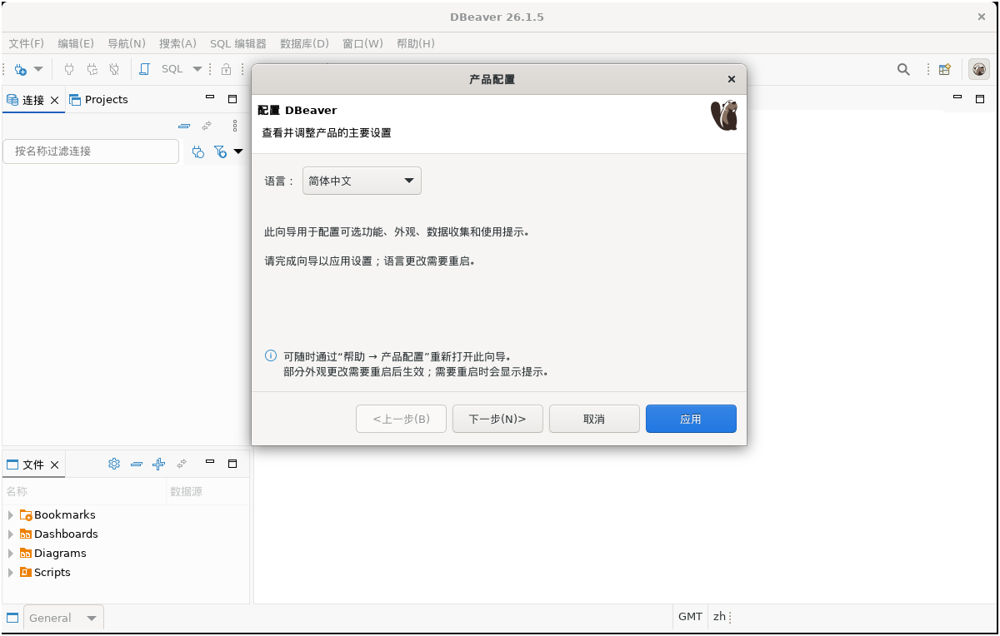

关闭窗口后，后台进程可能还需十几秒保存工作区并退出。请等待进程结束后再启动下一实例，否则可能出现 `Can't lock workspace`。

## 5. 首次创建连接与配置 JDBC 驱动

先按以下顺序完成连接，再进入存储过程或 Package 调试。详细全窗口截图与逐步标注见[在线操作手册](./GAUSSDB_GUI_OPERATION_MANUAL.md)，也可下载上面的 Word 手册离线查看。

1. 确认数据库管理员提供的主机、端口、数据库名、账号及兼容模式；数据库地址填写服务器可访问地址，而不是本机解压目录。
2. 通过“数据库 → 新建数据库连接”或工具栏“新建连接”进入向导，选择唯一的 **GaussDB** 入口；O/A/ORA 与 M 库都使用此入口。按以下步骤添加与目标库版本匹配的 JDBC JAR。
3. 填写连接参数；M 库勾选 **M 兼容库：mCompatible=true、yearIsDateType=true**，A/O 库不勾。此项只设置本连接的 JDBC 参数，不修改数据库兼容模式。 URL 模式请勿在查询串中重复填写 `mCompatible` 或 `yearIsDateType`；页面会提示移除冲突项，以保证勾选设置与实际生效值一致。执行“测试连接”，成功后完成向导，确认左侧“数据库导航器”可展开。
4. 展开目标数据库与 Schema，确认可以看到表及受支持的存储过程／函数／包；再按第 6、7 节配置调试和编译。


发布包不内置 GaussDB JDBC 驱动。请使用与目标数据库版本匹配、经过组织审批的驱动：

1. 启动 DBeaver，选择“数据库”→“驱动管理器”。
2. 选择 **GaussDB**，点击“编辑”；也可在新建连接向导里点击“编辑驱动设置”。
3. 在“库”页添加 GaussDB JDBC JAR。
4. 默认常用 `gsjdbc4.jar` 对应 `org.postgresql.Driver` 与 `jdbc:postgresql:`；若官方 JAR 实际使用 `com.huawei.gaussdb.jdbc.Driver`，在驱动编辑页配套设置 `jdbc:gaussdb:`。按 JAR 的实际类名与协议配套，不凭文件名判断，也不因 O 模式强制换包；不要混入多个冲突版本。
5. 保存后新建连接，填写主机、端口、数据库、用户名和密码。
6. 点击“测试连接”，成功后完成向导。再在 SQL 编辑器查询 `version()`、`current_database()`、`current_user` 和 `pg_settings.sql_compatibility`，确认真实目标；测试成功框不代替这些查询。

R3 新建连接列表统一为一个 **GaussDB** 入口；旧三个驱动定义仍在内部保留，已保存连接按原定义加载，驱动管理器仍可调整配置。本轮统一入口使用匹配的 `gsjdbc4.jar`，在两种架构上完成 GaussDB 507 A/M 真实连接、模式识别、M 参数保存与重新打开；另完成临时表、中文及 SQL NULL 绑定和回滚的 JDBC 验证。此结果不代表全部驱动版本或 M 数据类型均已验收。

客户端不会在后台静默修改会话级私有参数。若特定服务端能力要求额外参数，能力检查或错误信息会明确提示，由用户或数据库管理员确认后显式设置。

GaussDB 内置驱动默认取消“Thread safe driver”，使同一连接上的语句和结果读取互斥，避免多 Schema 并发刷新触发驱动内部异常；不同连接仍可并行。旧工作区或自定义驱动若显式启用了此选项，请在“数据库 → 驱动管理器 → 编辑驱动”中取消后重新连接。这是客户端选项，不修改数据库会话参数。

新版新建连接列表（统一 GaussDB 入口，旧连接定义保留）：

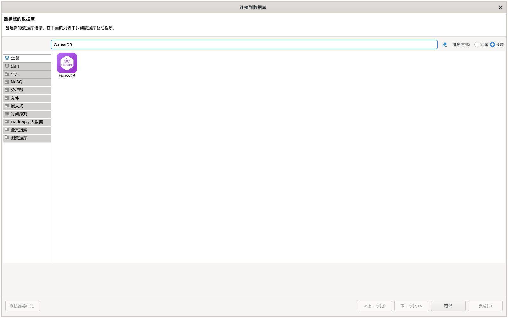

在连接向导的“主要”页选择 M 兼容选项；A/O 库不勾选：

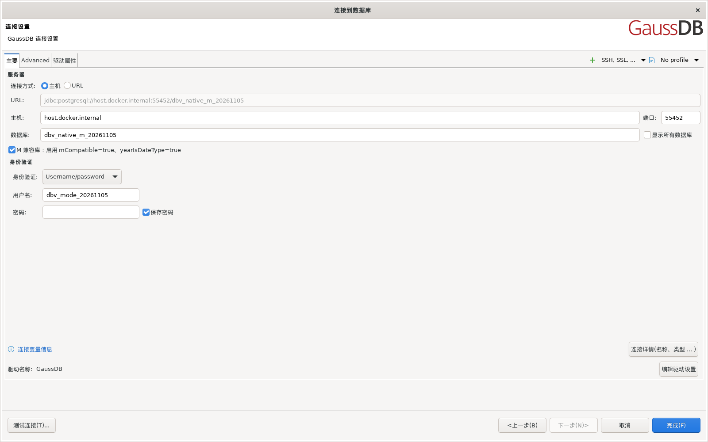

点击右下角“编辑驱动设置”查看或修改驱动类；主机模式下 JDBC 协议由实际驱动类生成，返回连接页核对实际 URL：

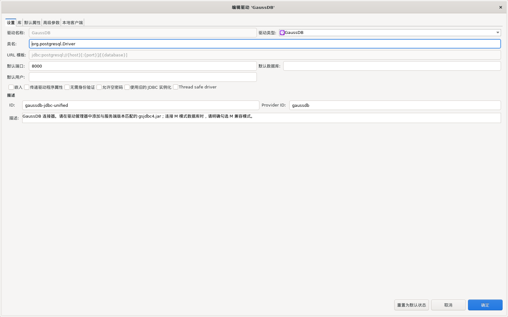

当前连接的 JDBC 参数位于“驱动属性”页，图中 `mCompatible=true` 对应已勾选的 M 选项：

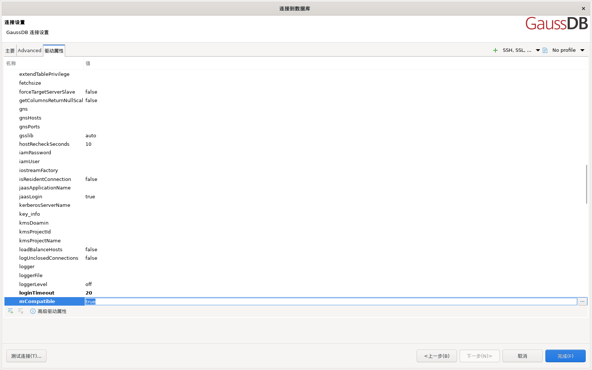

## 6. 调试存储过程或函数

### 6.1 启动调试

1. 在“数据库导航器”中展开目标数据库、模式及“存储过程”或“函数”。
2. 打开需要调试的对象并保存源码。
3. 在可执行代码行左侧标尺双击设置断点。
4. 选择“数据库”→“数据库调试...”，或工具栏调试（小虫）图标的下拉菜单→“数据库调试配置...”，新建数据库调试配置；具体例程的右键“调试方式”也可作为入口。
5. 选择数据源和例程，为所有 `IN`/`INOUT` 参数填写值。
6. 点击“调试”。

复合对象入参以数据库类型的文本格式填写，例如 `(1,张三)`；字段内包含逗号时为该字段加双引号，例如 `(2,"Alice, Jr.")`，整个输入值不再包一层 SQL 单引号。调试器依据参数真实类型 OID 读取所属 Schema，并在调用中限定用户定义类型的名称；过程和类型位于不同 Schema 时也能找到对应类型。内置数值、文本等参数沿用原有调用方式。

需要把整个参数设为 SQL NULL 时，在“输入方式”中选择 SQL NULL；不要用字符串值代替空值。当前仍通过文本输入复合对象，并未提供逐字段对象编辑器。

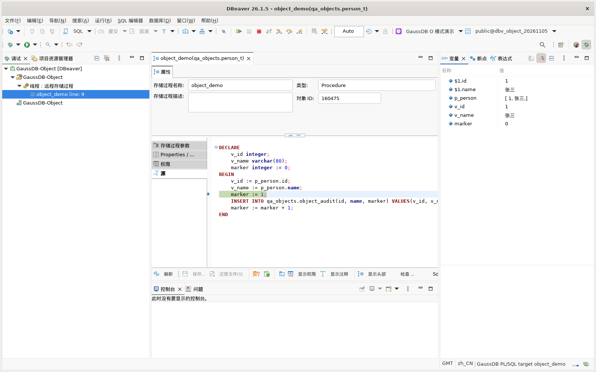

“运行”→“运行配置...”通用菜单仍保留，供其他启动类型使用；数据库调试类型只在“调试配置”中提供。普通 SQL 请在 SQL 编辑器中执行。旧版本若从“运行配置”中新建时提示 `No tab group defined`，先关闭该窗口并改用上述数据库调试入口，再更新到本页构建；不要删除工作区。

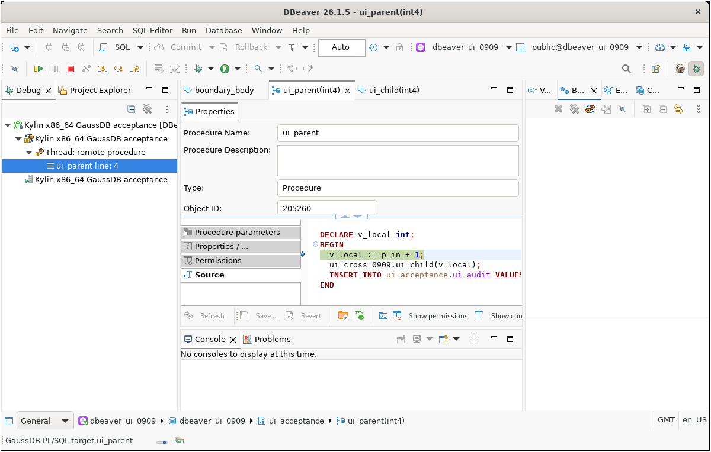

### 6.2 调试控制与变量

| 操作 | 快捷键 | 说明 |
| --- | --- | --- |
| 单步进入 | F7 | 进入当前行调用的过程或函数 |
| 单步跳过 | F8 | 执行当前行但不进入被调用对象 |
| 单步退出 | Shift+F7 | 运行到当前调用层返回 |
| 继续 | F9 | 运行到下一个断点或结束 |
| 终止 | F10 | 终止当前调试会话 |

在“变量”视图中可以查看局部变量；选择可修改变量后编辑其值。监视视图支持按变量名添加监视项。服务端拒绝的类型、常量或非法值会显示明确错误，不会伪装为修改成功。

查看游标状态：

1. 让过程在 `OPEN`、`FETCH` 或 `CLOSE` 之后的代码行暂停，打开“变量”视图。
2. 找到类型为 `refcursor` 或 `sys_refcursor` 的变量。服务端提供可识别的状态时，其值显示摘要，例如 `(ROWCOUNT=1, ISOPEN=true, FOUND=true, NOTFOUND=false)`。
3. 展开游标变量，查看只读子项 `%ISOPEN`（是否打开）、`%FOUND`（上次是否取到行）、`%NOTFOUND`（上次是否未取到行）和 `%ROWCOUNT`（服务端计数）。返回了游标名称时还会显示 `NAME`；包内游标还会显示 `PACKAGE`，用于区分不同包的同名游标。缺少的属性不会被补成 `false` 或 `0`；明确的空值显示 `NULL`。
4. 在“表达式”视图添加游标变量名（例如 `cur`）可查看整个状态；添加 `cur%ROWCOUNT` 或 `cur%ISOPEN` 可监视单项属性。游标名称区分大小写，属性名不区分大小写；只支持变量名和上述属性，不执行任意表达式。若所选帧有多个包的同名游标，未限定作用域的属性监视会提示名称有歧义，此时在“变量”视图展开对应 `PACKAGE` 的游标查看。
5. 单步执行，再查看下一次暂停时的值；切换调用栈帧后，显示所选帧的状态。保持“表达式”页签打开时，单步暂停不会强制切走到“断点”页签。

游标本身与状态子项均只读。对无法识别、存在冲突或无法唯一归属的服务端数据，保留原始值或独立变量行，不猜测状态归属。客户端只解析 `info_locals()` 已返回的数据，不额外执行 `FETCH`，不重新执行原查询，也不设置新的私有会话参数。**这里显示的是游标状态，不是游标结果集；暂停期间尚不提供结果行、原 SQL 或列结构预览，需服务端新增接口后再适配。**

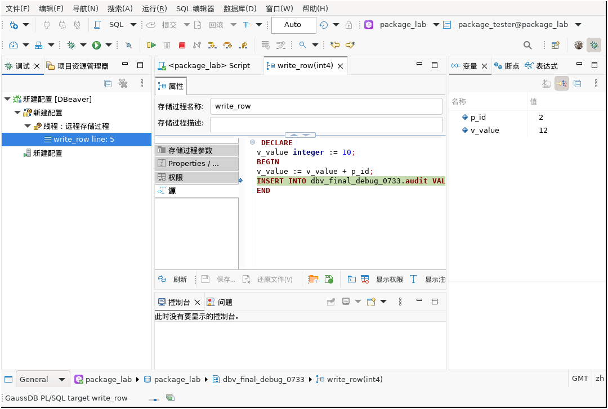

### 6.3 调用堆栈与事务处理

“调用堆栈”视图显示当前多层调用关系。选择不同栈帧时，源码位置和变量视图会随之刷新；双击栈帧可导航到对应过程或函数。

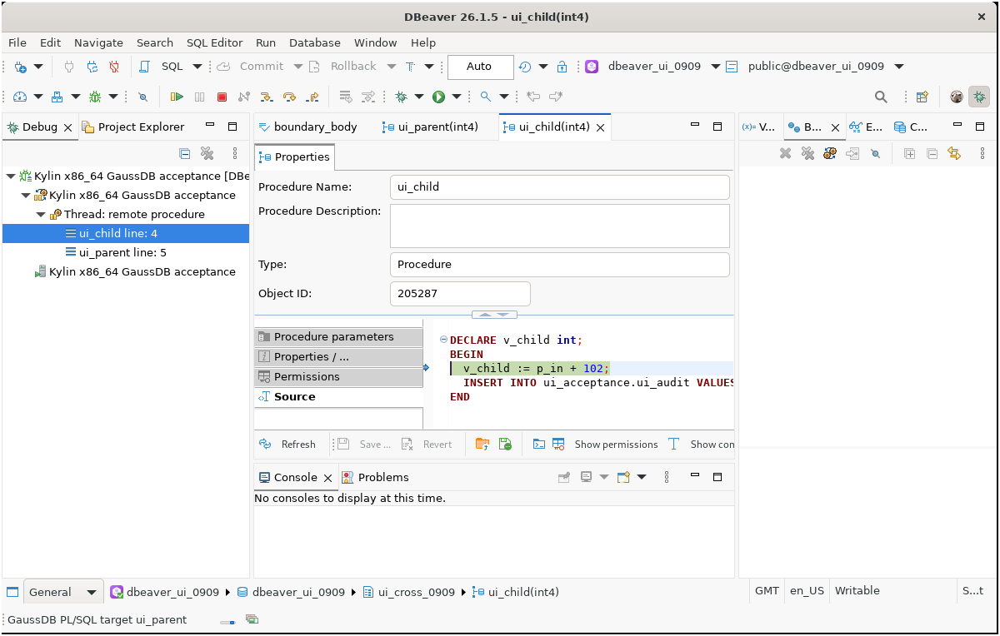

调试结束时，对话框默认选择“回滚剩余事务并结束”，只处理目标连接中尚未完成的剩余事务。若过程或函数内部已经执行 `COMMIT`，这些已提交的数据无法由结束时的“回滚”撤销；之后产生且仍未提交的修改才由本次选择处理。这里的“提交／回滚”处理数据库数据，不负责保存编辑器中的源码；源码修改应先在对象编辑器中保存并编译。

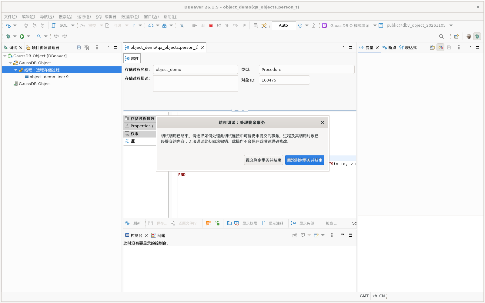

### 6.4 选择包内过程或函数

Package 内的成员不属于 Schema 下的独立“存储过程／函数”列表。新建调试配置时，选择 DBeaver 类型及目标连接，再在“调试对象”选择器展开：模式 → 目标 Schema → 包 → 目标包 → 存储过程 → 目标成员。选择包内函数时，展开同一包的“函数”分支。无输入参数的成员，其参数表为空正常。

包内成员调试需要事务级 `SET LOCAL search_path`。阅读配置页显示的参数及作用范围后，可以勾选仅为本次调试允许设置；未勾选时，点击“调试”会弹出确认框，列出连接、数据库、包内成员和参数说明。选择“否”会取消本次启动。一次确认使用后，再次点击工具栏调试或重新打开已保存的配置，需要为新的启动重新确认；客户端重启后也不会沿用上次确认。

已保存配置没有修改时，“应用”按钮置灰正常。“调试”按钮根据连接、例程及输入参数是否有效决定是否可用；仅未勾选参数确认不会使有效配置的“调试”按钮置灰，启动时仍会要求明确确认。

### 6.5 断点列表和源码页签

“断点”视图保存整个工作区已配置的断点，结束调试或重启客户端后仍会保留；这里不是本次执行的断点命中记录。同一连接可以有多个数据库、过程和代码行，因此连接标识相同不代表重复。只有同一连接、数据库、例程 OID 和行号相同的多条记录才属于重复。

断点标签显示连接标识，包括使用自定义标签的断点。对同一代码行切换断点时，会清除全部匹配的重复记录，并保留其他连接的断点。客户端不会自动清空历史断点；不再使用的断点可以在“断点”视图中选中后删除，或取消勾选以禁用。

在“断点”视图中，单击条目只选中断点，双击才打开源码并定位到断点行；仅切换到“断点”等视图页签不会自动打开源码。初次打开或加载较慢时，会等待源码文档加载完成，再定位执行行和执行箭头。关闭源码页签或切换到其他视图后，过期的异步源码加载结果会被忽略，避免源码页签再次打开或抢回焦点。

### 6.6 修改并保存存储过程源码

先结束本轮调试并处理剩余事务，再从导航树展开 **连接 → 数据库 → 模式 → 目标 Schema → 存储过程**，双击具体过程，在对象编辑器选择 **属性 → 源**。修改完整的 `CREATE OR REPLACE` 定义后按 **Ctrl+S**，检查保存 SQL 并确认。保存成功后重新启动调试；暂停中的代码不支持热替换。

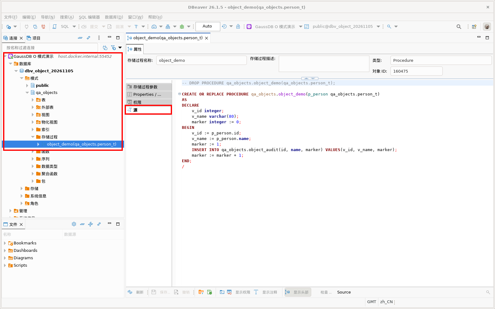

## 7. Package 编译和错误定位

1. 在支持 Package 的数据库中展开模式下的“包”。
2. 右键目标 Package。
3. 根据需要选择“编译包”“编译包规格”或“编译包体”。
4. 查看编译结果和错误列表。
5. 双击带行号的错误，跳转到对应源码位置。

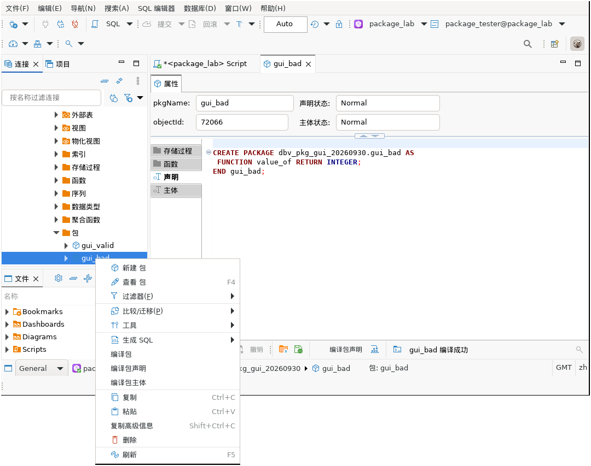

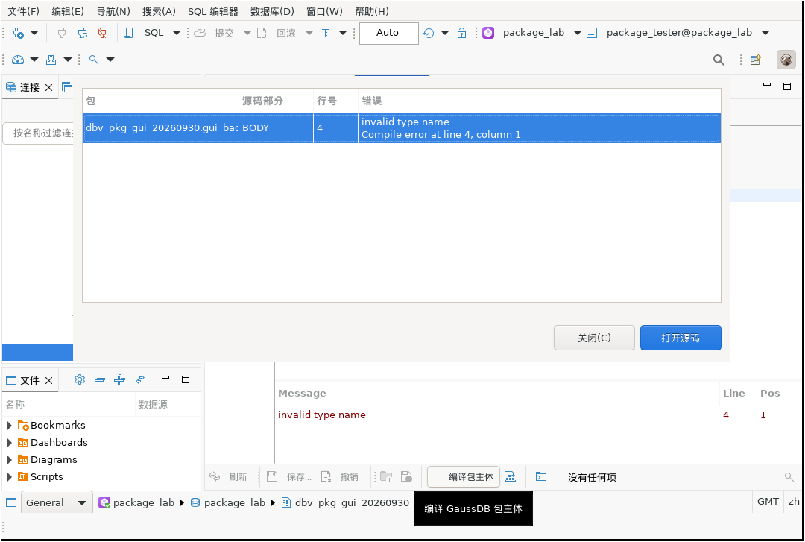

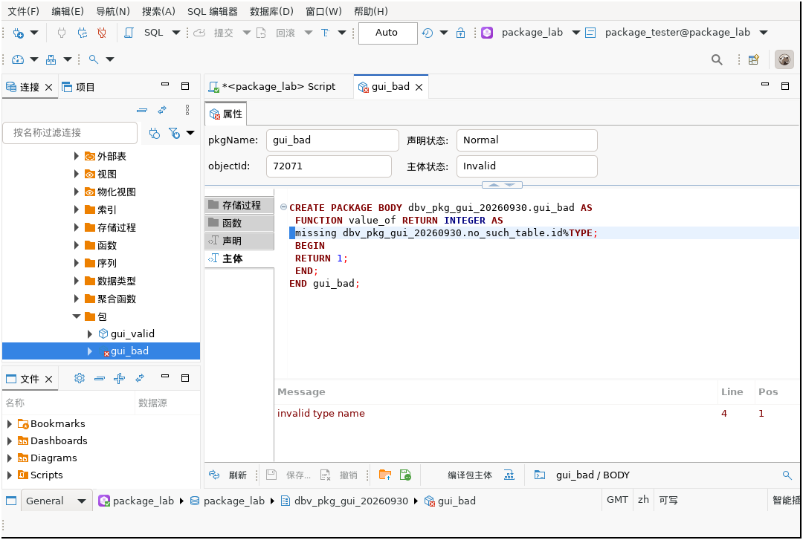

可以在数据库导航器中多选 Package 后执行删除。执行前会显示对象清单及确认对话框，便于复核批量操作范围。

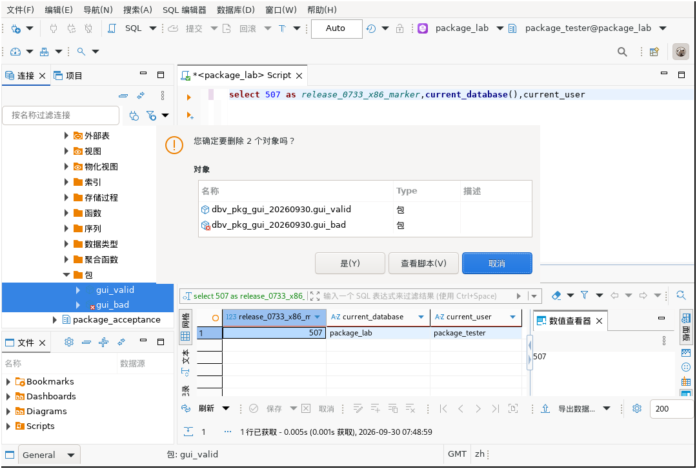

分布式版本若不支持强制创建无效包体或编译错误系统视图，客户端会显示服务端直接返回的编译错误，不会把该路径报告为“错误定位成功”。

## 8. 查看分区表和子分区

1. 在数据库导航器展开 **连接 → 数据库 → 模式 → 目标 Schema → 表**，双击目标分区表。
2. 在 **属性** 页查看 **分区依据**，例如 `RANGE (id)`、`LIST (region)`、`HASH (id)` 或 `INTERVAL (event_date)`。
3. 在属性页左侧选择 **分区**，右侧列表显示一级分区名称及 **分区表达式**。也可以在导航树展开该表下的 **分区** 文件夹。
4. 对二级分区表，继续展开 **分区 → 一级分区 → 子分区**。双击一级分区，在 **属性 → 子分区** 中查看二级分区列表及边界；一级分区自身的边界和下一级的分区依据会分别显示。
5. 在数据库中增删分区后，选中对应的父表或父分区，按 **F5** 刷新，再检查导航树和已打开的列表。叶子分区没有下一级时，不显示空的“子分区”入口。

例如，下图中 `orders_nested` 按 `id` 做 RANGE 分区，一级分区 `p_low` 的边界是 `VALUES LESS THAN (100)`；其下按 `region` 做 LIST 子分区，列表中显示 `VALUES ('CN')` 和 `VALUES (DEFAULT)`。RANGE 的无上界分区显示 `MAXVALUE`。这些是读取到的元数据，查看时不会修改分区定义。

窗口较窄时先最大化，必要时关闭右侧 Chat 页签，以便同时看到名称、分区依据和分区表达式列。

麒麟 V10 x86_64 容器中的实际客户端界面：

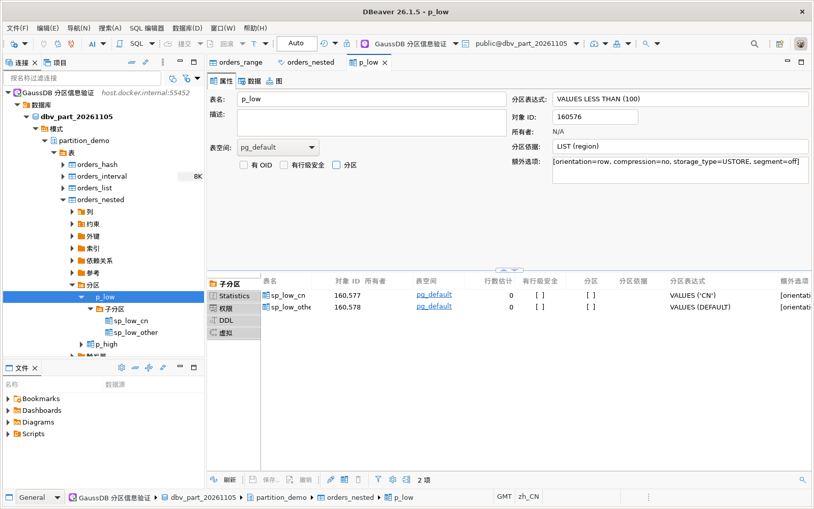

麒麟 V10 ARM64 容器中的相同操作：

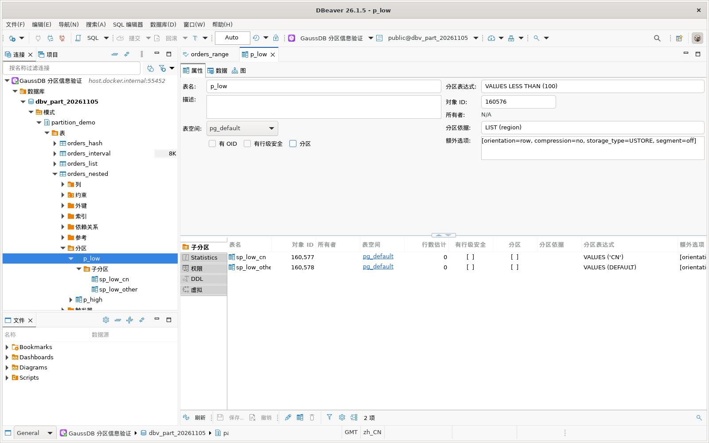

## 9. 验证结果

### 9.1 本轮 R3 验证

- 修复表结构页丢失分区属性的问题，展示真实列名组成的分区依据；一级边界与二级分区策略分别读取，INTERVAL 自动分区使用范围边界形式显示。
- 修复继承导航树后丢失二级分区入口的问题；只为 GaussDB 显式注册物理子分区节点，保留 PostgreSQL 原有导航配置。
- 修复刷新后保留旧子分区缓存的问题；刷新从 `pg_partition` 读取新对象并更新父节点缓存，不再把分区 OID 当作 `pg_class` 表 OID 查询。
- 主工程 OSGi JUnit 回归共 **3197 项：3013 通过、184 按条件跳过、0 失败、0 错误**；新增 15 项分区、7 项驱动入口及旧连接兼容、37 项连接参数校验，以及 1 项统一入口执行上下文回归。该完整回归运行于构建机，未宣称全部在 ARM 上重跑。
- 43 项打包脚本检查通过，204 个产品构建模块成功；两个架构的归档分别完成重新解压和 1202 项应用文件清单核对。
- 两种架构均在麒麟 Linux Advanced Server V10（Lance）容器中运行真实图形客户端，连接同一 GaussDB 507 集中式 ORA 库。x86_64 用户态通过宿主机指令转译运行，ARM64 使用原生 ARM64 用户态；两者共享宿主机 LinuxKit 内核。

| 本轮客户端检查 | x86_64 | ARM64 |
| --- | --- | --- |
| 启动、数据库连接 | 通过 | 通过 |
| 新建连接仅一个 GaussDB，A/M 实库连接及 M 功能门控 | 通过 | 通过 |
| M 复选项保存及重开、URL 参数冲突提示、驱动类和 JDBC 属性页 | 通过 | 通过 |
| RANGE、LIST、HASH、INTERVAL、带引号列名、普通表及二级分区表，共七表矩阵 | 通过 | 通过 |
| 一级分区展开、子分区入口、属性页子分区列表与边界 | 通过 | 通过 |
| 叶子节点隐藏空的下一级入口 | 通过 | 通过 |
| 同一连接保持缓存，新增子分区后 F5，树和列表从 2 项变为 3 项 | 通过 | 通过 |
| 删除该子分区后 F5，树和列表从 3 项恢复为 2 项 | 通过 | 通过 |

七表的实际元数据、属性描述符和边界结果逐行一致；两份产品中 451 个同名共享 JAR 字节一致。本轮 ARM 验证范围是上述图形界面与元数据冒烟对照，不等于全部历史调试、Package 用例或客户桌面云场景已在 ARM 完成验收。

### 9.2 既有验证记录

以下按原构建日期保留既有结果。本轮 R3 新执行的检查见上节；历史 GUI、505 服务端及其他环境的全部场景没有随本轮重新执行。

历史 2026-11-05 R2 是连接操作手册和源码交付修订。Java 插件仍为 R1 构建，不将下面的 R1 全量回归记录表述为 R2 已重新执行。新增连接操作图的验证情况：麒麟 V10 x86_64 转译容器连接 507 集中式 ORA，从全新连接向导选择原生驱动、添加本地 JDBC、填写连接字段、不保存密码时完成认证、测试成功、保存连接、展开目标 schema 和表、打开 SQL 编辑器，真实查询确认 Kernel 507、当前库/用户及 sql_compatibility=A，并打开错误日志视图；形成 13 张全窗口截图。新版 Word 为 43 页、24 图，已全页检查。

2026-11-05 R1 构建的验证结果：

- 修复跨 Schema 复合对象参数调用：根据参数真实类型 OID 读取类型所属 Schema，调用时限定用户定义类型名称，避免类型不在当前搜索路径中时启动失败；内置参数类型保持原有形式。
- 事务结束对话框明确只处理剩余事务，提示过程内部已提交数据不能回滚，且该操作不保存源码；默认选择回滚。
- 主工程回归：3137 项，2953 通过、184 项按条件跳过、0 失败、0 错误；比 R6 新增 7 项回归。204 个产品构建模块成功，最终解压通过 1202 项产品文件清单校验；6 个关键生产插件与实际 GUI 验收副本字节一致。
- 507 集中式 ORA 图形验证：在通过 Rosetta／指令转译运行、共享 LinuxKit 内核的麒麟 V10 x86_64 容器中，复合对象 `(1,张三)` 与包含逗号的 `(2,"Alice, Jr.")` 均启动调试并暂停，字段值读取正确；实际提交后，独立连接读回结果与输入一致。
- SQL NULL 与过程内部 COMMIT 验证：整对象 SQL NULL 入参成功启动并结束，提交后由独立连接确认空值记录；两个复合对象样例与空值样例各读回一行。507 的 `info_locals()` 对 NULL 复合字段可显示 `0／<UNKNOWN>`，不将该占位显示当成字段真实值。内部 COMMIT 用例先插入 901 并提交，再插入 902；结束时选择“回滚剩余事务并结束”，独立连接确认 901 保留、902 不存在，且无存活调试目标或进程。

以下 2026-11-03 R6 及更早构建为历史记录，不表示其全部场景已在本次重跑：

2026-11-03 R6 构建的验证结果：

- R6 游标状态：支持 507 `info_locals()` 的内联状态文本，以及按游标名称关联的旧式隐藏属性格式。按完整游标名称、Package 和栈帧精确关联；缺失、非法、重复及冲突数据保留可见信息。状态摘要与子项只读，支持游标整体及 `%ISOPEN`、`%FOUND`、`%NOTFOUND`、`%ROWCOUNT` 监视。
- R6 监视刷新：保留变量与属性快照的稳定身份；暂停时只创建缺少的调试视图，不强制激活“变量／断点”，使当前“表达式”页签保持可见。
- R6 主工程回归：3130 项，2946 通过、184 项按条件跳过、0 失败、0 错误；本次新增 87 项回归。
- R6 真库协议验证：507 集中式 ORA，游标打开、FETCH 命中／未命中、关闭、多个游标及调用栈帧切换；86 项断言连续执行两轮，两轮均通过。旧式按名称隐藏属性格式以提供的协议样例做单元验证，未声明本次已在 505 服务端验证该格式。
- R6 产品构建及图形验收：204 个 Maven 模块全部构建成功。最终 R6 在麒麟 V10 x86_64 转译容器中，使用全新工作区连接 507 集中式 ORA；真实“变量”和“表达式”视图中的游标及 cur%ROWCOUNT 监视随 OPEN、第一次和第二次 FETCH、耗尽后的 NOTFOUND、CLOSE 正确刷新。两个视图均能完整展开四项状态和 NAME，只读保护有效；所选栈帧、源码光标和执行箭头均匹配第 10 行。F9 正常执行至结束后选择回滚，确认无存活调试目标或进程并正常退出。6 个生产插件与最终图形验收副本字节一致，归档解压后通过 1202 项文件清单校验。同帧跨 Package 同名游标隔离与歧义检查由单元测试覆盖，本次不声明该组合已通过 GUI 验收。

以下 R5、R4、R3、R2 为历史验证记录，不表示其全部场景已在 R6 重跑：

- R5 修复调试完成状态同步：继续或单步后及时同步目标与线程的运行状态，清除过期调用栈；再次暂停时重新读取调用栈。等待提交/回滚期间禁用“继续”，忽略已排队但过期的继续操作，避免完成后的会话被当作仍可恢复的暂停会话。
- R5 修复包内单步的结束识别：507 真库的独立 JDBC 协议探测发现，子过程执行到 END 时也可能返回 `[EXECUTION FINISHED]`，此时调用栈中仍有子帧和调用者。客户端现对返回标记做精确匹配，并在同一控制连接读取调用栈；有调用栈时继续按暂停处理，不以 OID 判断调用是否结束，以覆盖递归使用相同 OID 的情况。只有目标 CALL 成功返回才确认例程结束；调用栈查询仅将预期的 `D0005` 作为收尾信号，其他异常仍上报。该服务端行为已通过独立协议探测及下述新版客户端图形验证复核。
- R5 精确匹配错误响应标记：源码字符串或注释中的相似文字不会被误当作调试错误；真正的服务端错误标记仍终止本次调试并报告错误。
- R5 主工程回归：3043 项，2859 通过、184 项按条件跳过、0 失败、0 错误；本次新增 45 项回归（19 项模型状态及竞态、26 项结束/错误标记识别）。下列 R4、R3、R2 图形验证为历史结果，不能视为已用 R5 重跑。
- R5 真库图形验证：麒麟 V10 x86_64 转译容器连接 GaussDB 507 集中式 ORA。旧 R4 复现了“已结束”但调用栈仍有两帧、继续报 `not suspended` 的问题；R5 经 F7 进入 run_demo → build_result → calc_amount，跨过服务端返回的 build_result 第 0 行后返回 run_demo 第 8 行，再单步至正常完成。另一轮在 build_result 第 0 行确认仍可继续且未完成，点击“继续”后正常完成。
- R5 事务验证：最终提交/回滚对话框显示期间，“继续”和单步动作均不可用。第一轮提交后独立连接查得 1 行；第二轮选择回滚后，独立连接行数仍为 1。
- R5 产品构建：204/204 个 Maven 模块成功，6 个涉及修复的生产插件与实际图形验收副本字节一致。

- R4 产品构建：204/204 个 Maven 模块成功；发布包解压后通过 1202 个文件条目的清单校验，6 个涉及修复的生产插件与图形验收副本一致。
- R4 主工程回归（历史）：2998 项，2814 通过、184 项按条件跳过、0 失败、0 错误；当时新增 29 项回归，并保留 R3 已新增的 69 项回归。
- R4 真库图形验证：保留 R3 工作区中的真实断点跨版本重启。单击仅选中且不打开编辑器；双击首次打开、对象停在“属性”页后二次双击、右键“转至文件”均切到源码第 6 行。模拟源码查询延迟 8 秒后仍定位第 6 行；关闭全部编辑器后重复单击不重开源码。
- R4 启动验证：“运行配置”只显示其他可运行类型，“调试配置”中保存的数据库配置有效且“调试”可用；实际启动包内 run_demo，暂停时光标和执行箭头均位于第 6 行，继续后选择回滚并结束会话。
- R3 真库图形验证：包内调试逐次明确确认，取消后无存活调试目标或进程；初次暂停、双击重开、F7 三层调用的光标和执行箭头分别匹配源码第 6、4、6 行。关闭源码或真实鼠标切回断点页后，等待 10 秒不重开或抢回焦点。
- R2 已完成：麒麟 V10 x86_64 图形环境连接本地 GaussDB 507 集中式真库；100 个批量 Schema，数据库约 1.5 万个过程、3000 个函数、208 个包和 3900 个合成复合类型。
- R2 已完成：两份 JDBC 驱动各完成三轮并发刷新；每轮 500 个任务、12 个工作线程。旧版复现的驱动并发异常未再出现。
- R2 已完成：M 模式主连接和元数据连接初始化、表数据读取、调试参数面板创建通过。
- R2 新增 23 项回归测试；GUI 验证历史重复断点重启恢复、删除匹配项并保留其他连接；新配置选择包内 run_demo，F7 进入 build_result、calc_amount，三层堆栈、各帧变量与正确源码可用，F8 后金额为 30；提交增加一行、再次调试回滚后行数不变。
- R4 与 R3 图形验证均使用 Apple Silicon 上的 Rosetta 转译麒麟 V10 x86_64 容器及 507 集中式 ORA 服务端；R2 曾在同一服务端验证 505 JDBC 驱动。这些结果不等同于 505 服务端或原生 x86 桌面云验收。

此前 2026-10-14 基线完成过 505 集中式、分布式真库及独立验收；本次没有重新运行该历史验收的全部场景。目标环境持续加载是否与已修复的驱动并发异常为同一原因，仍需升级后现场复测。

## 10. 当前边界

- 本 Release 提供麒麟 V10 x86_64 和 ARM64/aarch64 包，不提供本轮未构建及验收的 Windows、macOS 包。
- 既有对象参数 GUI 验证限于上述复合类型样例，不声明所有用户定义对象、数组或 domain 类型均已图形验收。本轮 ARM 仅完成第 9.1 节列出的分区冒烟对照；两种容器结果均不替代客户物理机、原生麒麟内核或桌面云准入验收。
- 包内本地重建的 Linux 原生库未进行数字签名，请以本页公布的 SHA-256 和产品文件清单校验完整性。
- GaussDB JDBC 驱动、`gs_dump`、`gs_restore` 等数据库原生工具不随客户端分发。
- PL/SQL 调试依赖服务端调试接口、兼容模式、例程语言和用户权限。
- Package 错误定位依赖目标版本提供相应的 Package 和编译诊断能力。
- 暂停调试中的局部游标仅支持服务端返回的状态；结果行、原 SQL 和列结构预览仍依赖后续内核接口。旧式按名称隐藏属性仅完成协议样例单测，既有真库游标验证覆盖的是 507 内联状态格式。
- 首次用于目标环境时，应按照组织的软件准入流程核对摘要，并完成连接、调试、事务和 Package 场景验收。

## 11. 从交付源码构建

完整源码归档包含相邻的 `dbeaver/` 与 `dbeaver-common/`。`dbeaver-common` 固定为官方提交 `2df03e58480c6325732f476e8355e375cec5405e`，不要替换为以后变化的最新分支；源码修订和上游地址见[组件记录](./SOURCE-REVISIONS.json)与归档内 `SOURCE-MANIFEST.json`。

在安装 JDK 21 或更高版本、Maven 3.9.x 的构建机上，解压归档，进入其中的 `dbeaver` 目录后执行。将下面的 JDK 路径替换为本机实际路径，并通过 `mvn -v` 确认它使用 Java 21+：

```bash
export JAVA_HOME=/absolute/path/to/jdk-21
export PATH="$JAVA_HOME/bin:$PATH"
java -version
mvn -v
mvn -f product/aggregate/pom.xml -Pproduct-dbeaver-ce package \
  -DskipTests=true -Dskip-checkstyle=true -Dspotless.check.skip=true \
  -DforceContextQualifier=20261105r3 \
  -Dbuild-timestamp=20261105r3
```

本次应用构建限定符为 `20261105r3`，交付修订为 `20261105-r3`。`-DskipTests=true` 仅用于打包，不表示执行了测试。构建需要 Maven/P2 依赖可访问，或事先准备齐全并匹配的离线依赖缓存；只下载源码不能保证完全离线自动构建。

该命令生成 Java/Eclipse 产品。复现本次麒麟归档还需要匹配架构的原生库、固定版本的 SWT／Equinox 源码、JRE、Node.js 22+ 及组装工具，具体见源码内 `product/community/kylin/README.zh-CN.md` 和 `THIRD-PARTY-SOURCES.md`。源码可复核与目标平台构建验证不等于重新构建文件必然逐字节相同。上游或历史 Markdown 文件属于源码资料，客户日常操作以本页链接的 V1.10 操作手册为准。

## 12. 许可证

DBeaver Community 源码及本增强版本遵循其适用的 Apache License 2.0。第三方组件继续遵循各自许可证；包内保留许可证和第三方源码获取说明。
