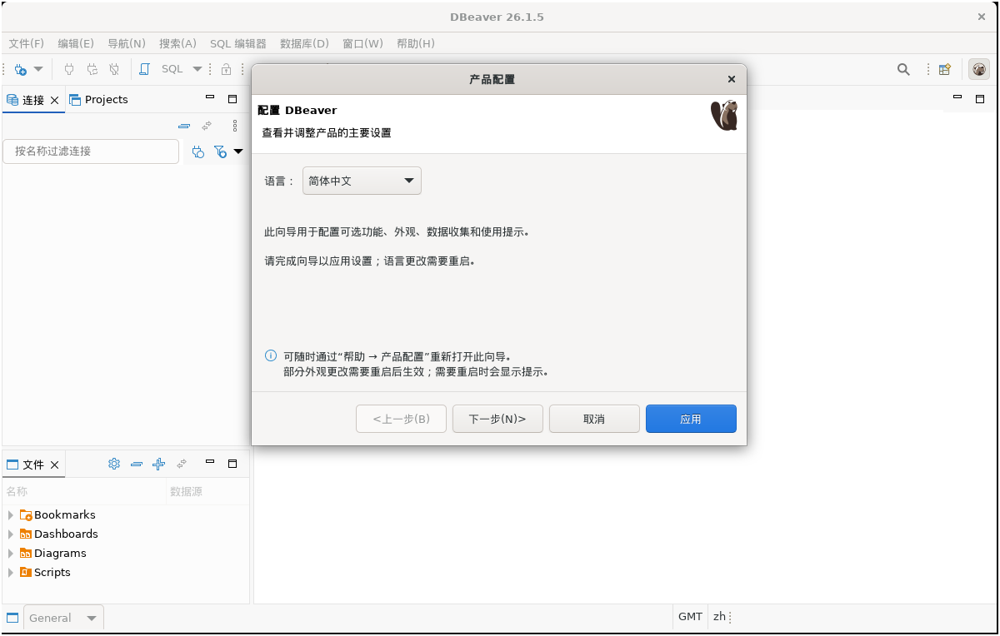
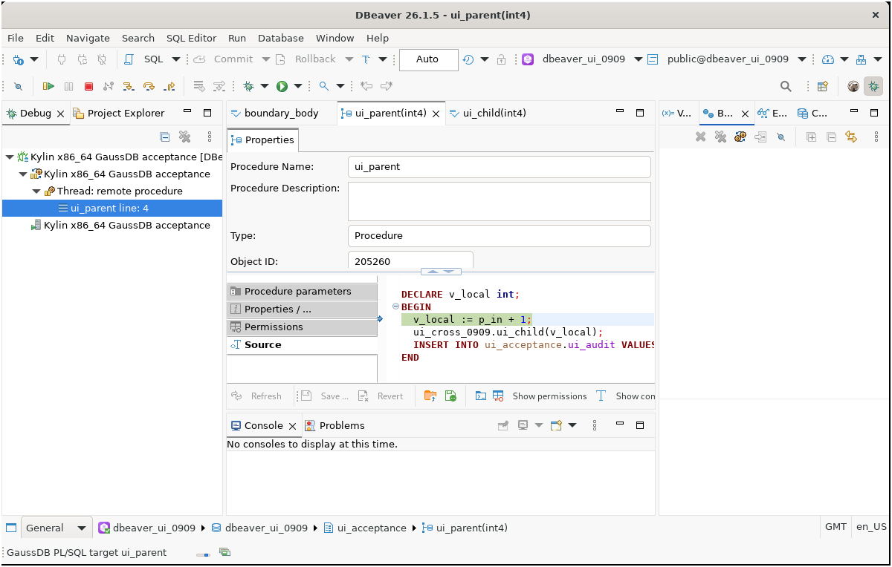
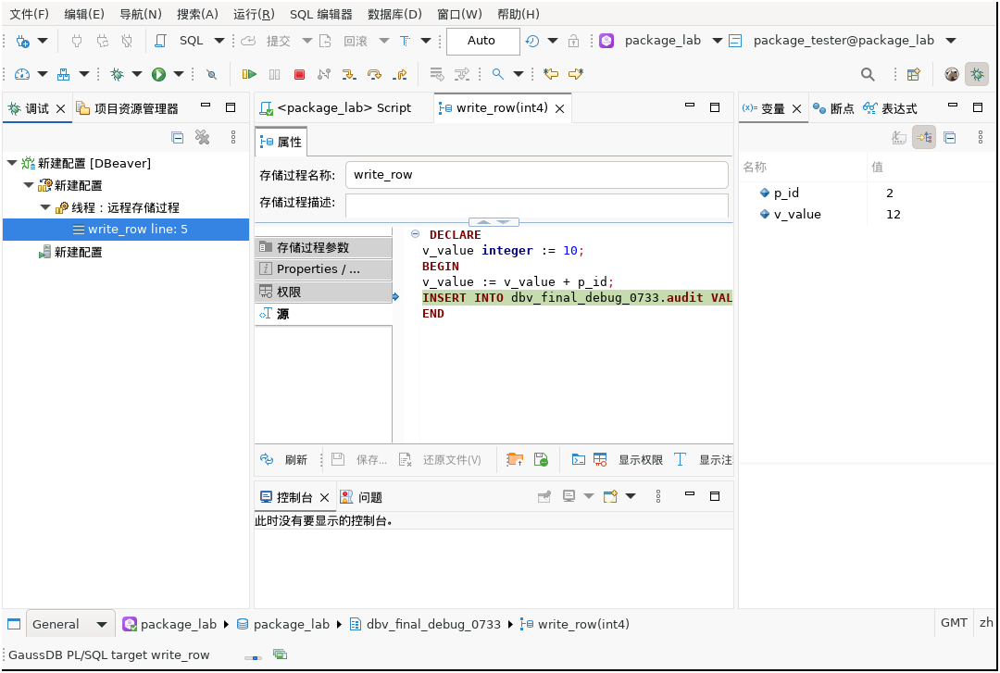
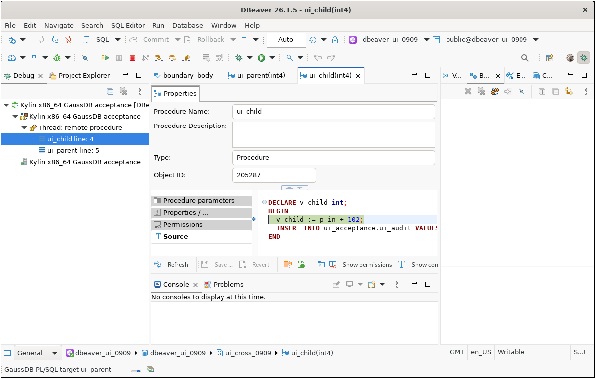
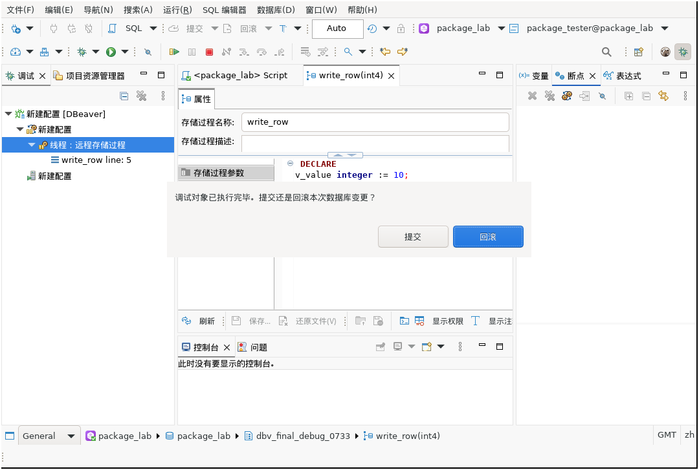
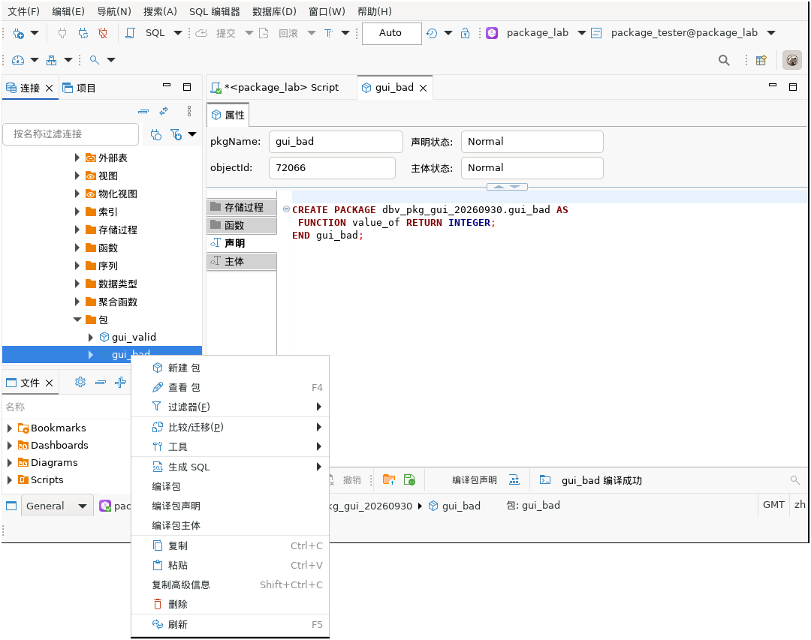
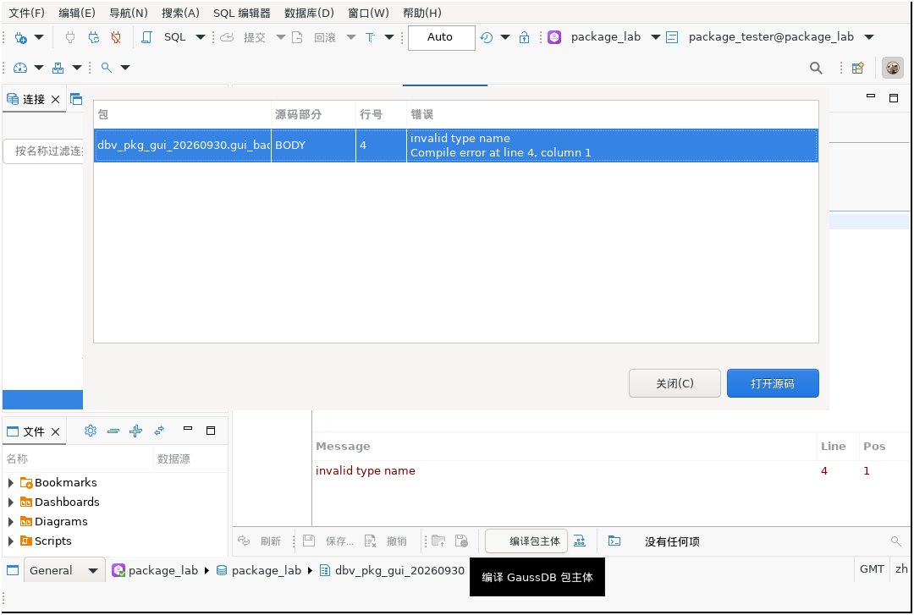
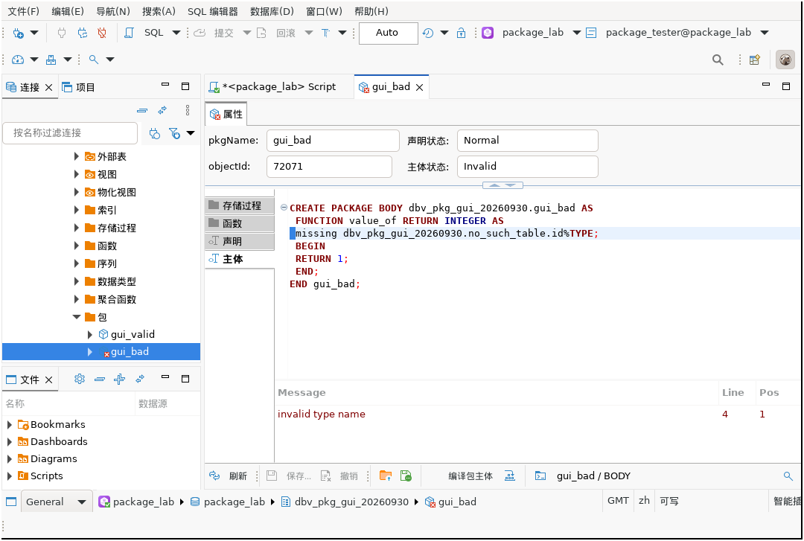
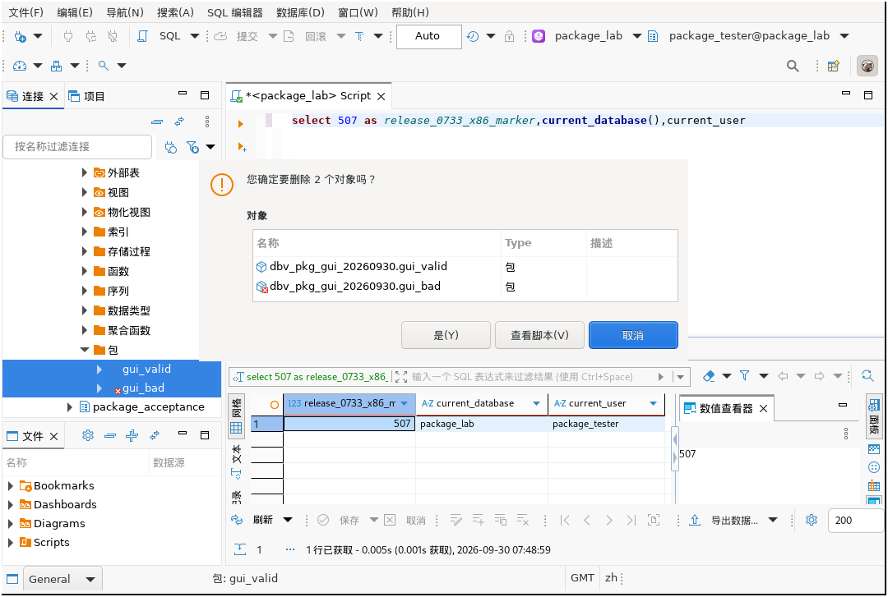

# DBeaver 26.1.5 GaussDB Enhanced Edition Guide

## 1. Overview

This edition is based on the official DBeaver 26.1.5 source tree and its GaussDB core plug-in. It extends DBeaver for GaussDB application development, stored routine debugging, and Package management.

It reuses the official DBeaver object model, SQL editor, Eclipse RCP platform, and generic debug framework, and adds:

- GaussDB compatibility-mode detection and capability-based feature gating.
- Breakpoint debugging for stored procedures and functions.
- Step Into (F7), Step Over (F8), Step Return (Shift+F7), Resume (F9), and Terminate (F10).
- Breakpoint creation, enable/disable, deletion, and centralized management.
- Local variable inspection and modification, watches, call stacks, and source navigation.
- Commit or rollback selection when a debug session finishes.
- Package specification, body, and full compilation, compile-error navigation, and batch deletion.

Source baselines:

- [DBeaver GaussDB enhanced source tag](https://github.com/jarrenL/dbeaver/tree/gaussdb-2615-20261014)
- Source revision: `3a20ec0742936c1bcfa861e2f0470b1eb980e8d4`
- [Independent test project](https://github.com/jarrenL/gaussdb-dbeaver-tests)
- Test revision: `96690286a163c0f3898fab3d3877098520384f3d`

## 2. Scope

| Item | Current release scope |
| --- | --- |
| Client version | DBeaver 26.1.5 GaussDB Enhanced Edition |
| Client platform | Kylin V10 x86_64 |
| Validated database | GaussDB 505.2.1.SPC0800, centralized and distributed deployments |
| Compatibility modes | Detects ORA/A, MYSQL/B, TD/C, PG, and M; features are enabled according to server capabilities |
| PL/SQL debugging | Enabled when the server provides the required `DBE_PLDEBUGGER` signatures and the current user has permission |
| Package management | Full capability is intended for Package-capable centralized ORA deployments; other deployments use capability-based fallback behavior |

M compatibility mode supports connections, object browsing, and basic SQL operations. This release does not claim PL/SQL debugging support for M mode. The client checks compatibility mode, routine language, debug API signatures, and permissions before starting a session and displays an explicit reason when a requirement is not met.

## 3. Download and integrity verification

The ecosystem release currently contains only the recently validated Kylin V10 x86_64 client:

- [Release page](https://github.com/huaweicloud-samples/database-gaussdb-ecosystem/releases/tag/dbeaver-gaussdb-26.1.5-kylin-x86_64-20261014)
- [DBeaver-GaussDB-26.1.5-202610140553-KylinV10-x86_64.tar.gz](https://github.com/huaweicloud-samples/database-gaussdb-ecosystem/releases/download/dbeaver-gaussdb-26.1.5-kylin-x86_64-20261014/DBeaver-GaussDB-26.1.5-202610140553-KylinV10-x86_64.tar.gz)
- [Product manifest](https://github.com/huaweicloud-samples/database-gaussdb-ecosystem/releases/download/dbeaver-gaussdb-26.1.5-kylin-x86_64-20261014/DBeaver-GaussDB-26.1.5-202610140553-KylinV10-x86_64.PRODUCT-MANIFEST.json)
- [SHA256SUMS](https://github.com/huaweicloud-samples/database-gaussdb-ecosystem/releases/download/dbeaver-gaussdb-26.1.5-kylin-x86_64-20261014/SHA256SUMS)

SHA-256:

```text
9ce40956dde52360ca3928f600b2d3fd5add036c174c6c9261105a932bfe1484  DBeaver-GaussDB-26.1.5-202610140553-KylinV10-x86_64.tar.gz
```

Verify the download and architecture:

```bash
sha256sum DBeaver-GaussDB-26.1.5-202610140553-KylinV10-x86_64.tar.gz
uname -m
```

`uname -m` must report `x86_64`, and the digest must match the value above. This package cannot run on ARM64/aarch64 systems.

## 4. Installation and startup

The release is a portable archive with a bundled Java 21 runtime. Extract it into a new directory instead of overwriting an active installation.

```bash
tar -xzf DBeaver-GaussDB-26.1.5-202610140553-KylinV10-x86_64.tar.gz
cd linux-x86_64/dbeaver
./dbeaver
```

If the launcher is not executable:

```bash
chmod +x dbeaver
./dbeaver
```

To force Simplified Chinese at startup:

```bash
./dbeaver -nl zh
```



After the main window closes, background processes may need several seconds to save and release the workspace. Wait for the previous process to exit before starting another instance, or DBeaver may report `Can't lock workspace`.

## 5. Configure the GaussDB JDBC driver

The distribution does not bundle a GaussDB JDBC driver. Use an organization-approved driver that matches the target database version:

1. Start DBeaver and select **Database** > **Driver Manager**.
2. Select `GaussDB` and choose **Edit**.
3. Add the GaussDB JDBC JAR on the **Libraries** page.
4. Confirm that the driver class is the GaussDB JDBC class supplied by that package.
5. Create a connection and enter the host, port, database, user, and password.
6. Run **Test Connection** and confirm the server version, compatibility mode, and user.

The client does not silently alter private session parameters. If a server capability requires an additional parameter, the capability check or server error reports it explicitly so that a user or database administrator can review and set it deliberately.

## 6. Debug a stored procedure or function

### 6.1 Start a debug session

1. In **Database Navigator**, expand the database, schema, and **Procedures** or **Functions** node.
2. Open the routine and save its source.
3. Double-click the editor ruler beside an executable line to add a breakpoint.
4. Right-click the routine and choose **Debug As** > **GaussDB routine**, or create a GaussDB entry in **Debug Configurations**.
5. Select the data source and routine, then provide values for all `IN` and `INOUT` parameters.
6. Choose **Debug**.



### 6.2 Execution control and variables

| Action | Shortcut | Description |
| --- | --- | --- |
| Step Into | F7 | Enter the procedure or function called by the current line |
| Step Over | F8 | Execute the current line without entering the callee |
| Step Return | Shift+F7 | Continue until the current call frame returns |
| Resume | F9 | Continue to the next breakpoint or completion |
| Terminate | F10 | Terminate the current debug session |

The **Variables** view displays local variables and permits supported values to be changed. The watch view accepts variable names. Server-rejected types, constants, and invalid values are displayed as errors and are never reported as successful updates.



### 6.3 Call stack and transaction result

The **Call Stack** view displays nested routine calls. Selecting another frame refreshes source navigation and variables; double-clicking a frame opens the corresponding routine.



At the end of a session, choose whether to commit or roll back data changes produced during debugging. Rollback is the safer default in shared or production-like environments.



## 7. Package compilation and error navigation

1. Expand **Packages** under a schema in a Package-capable database.
2. Right-click a Package.
3. Select full Package, specification-only, or body-only compilation.
4. Review the compilation result and error list.
5. Double-click an error with a line number to navigate to the matching source line.







Multiple Packages can be selected in Database Navigator for batch deletion. The client displays the object list and asks for confirmation before execution.



If a distributed server does not support forced invalid Package bodies or compilation diagnostic views, the client displays the direct server error and does not report compile-error navigation as successful.

## 8. Validation results

The release was validated as follows:

- Product build: 204/204 Maven modules succeeded.
- Packaging tests: 43/43 passed.
- Main project regression: 2,867 total, 2,683 passed, 184 conditionally skipped, 0 failed, and 0 errors.
- Independent acceptance gate: 337/337 passed.
- GaussDB 505 distributed live-database acceptance passed.
- GaussDB 505 centralized live-database acceptance passed 12/12, including debug protocol, session control, and a three-frame Package call stack.
- The final Kylin V10 x86_64 archive passed a clean-workspace, Simplified Chinese UI, and GaussDB debug plug-in cold-start check.

The x86_64 GUI check used a Kylin V10 x86_64 user space with instruction translation on the host. It does not replace final admission testing on the target physical machine or virtual desktop.

## 9. Current boundaries

- This ecosystem release contains only the Kylin V10 x86_64 package; ARM64 and Windows packages are not included.
- Locally rebuilt Linux native libraries in the package are not digitally signed. Verify integrity with the published SHA-256 digest and product manifest.
- GaussDB JDBC, `gs_dump`, `gs_restore`, and other native database tools are not distributed with the client.
- PL/SQL debugging depends on server debug APIs, compatibility mode, routine language, and user permissions.
- Package error navigation depends on Package and compilation-diagnostic capabilities in the target server version.
- Before first use in a target environment, verify the digest and run organization-specific connection, debugging, transaction, and Package acceptance tests.

## 10. Licensing

DBeaver Community source and these enhancements are provided under the applicable Apache License 2.0 terms. Bundled third-party components remain under their respective licenses; third-party source and license information is included in the package.
