# DBeaver 26.1.5 GaussDB Enhanced Edition Guide

Application build: `26.1.5.20261105r3`; delivery revision: `20261105-r3`; updated on 2026-11-05. R3 fixes partition properties, subpartition navigation and refresh, and delivers both Kylin V10 x86_64 and ARM64 clients.

## 1. Overview

This edition is based on the official DBeaver 26.1.5 source tree and its GaussDB core plug-in. It extends DBeaver for GaussDB application development, stored routine debugging, and Package management.

It reuses the official DBeaver object model, SQL editor, Eclipse RCP platform, and generic debug framework, and adds:

- GaussDB compatibility-mode detection and capability-based feature gating.
- Breakpoint debugging for stored procedures and functions.
- Step Into (F7), Step Over (F8), Step Return (Shift+F7), Resume (F9), and Terminate (F10).
- Breakpoint creation, enable/disable, deletion, and centralized management.
- Local variable inspection and modification, watches, call stacks, and source navigation.
- `refcursor` / `sys_refcursor` state summaries, read-only attributes, and attribute watches.
- Commit or rollback selection when a debug session finishes.
- Package specification, body, and full compilation, compile-error navigation, and batch deletion.
- Partitioning strategy and keys, physical partitions and subpartitions, boundaries, and refresh.

Source baselines:

- [Complete enhanced source in this ecosystem release](https://github.com/huaweicloud-samples/database-gaussdb-ecosystem/releases/download/dbeaver-gaussdb-26.1.5-kylin-20261105-r3/dbeaver-gaussdb-enhanced-source-20261105-r3.tar.gz)
- Java functional revision: `83c09896ee825b0b10c2462ef10001733128d087`; see [SOURCE-REVISIONS.json](./SOURCE-REVISIONS.json) for the complete delivered-source revision.
- [Independent test project](https://github.com/jarrenL/gaussdb-dbeaver-tests)
- Test revision: `96690286a163c0f3898fab3d3877098520384f3d`

- [Illustrated GUI operation manual (Chinese)](./GAUSSDB_GUI_OPERATION_MANUAL.md)
- [Detailed V1.10 operation manual (Word download)](https://github.com/huaweicloud-samples/database-gaussdb-ecosystem/releases/download/dbeaver-gaussdb-26.1.5-kylin-20261105-r3/GaussDB_DBeaver_Debug_and_Package_Manual_20261105.docx)
- [Source components and revisions](./SOURCE-REVISIONS.json)

## 2. Scope

| Item | Current release scope |
| --- | --- |
| Client version | DBeaver 26.1.5 GaussDB Enhanced Edition |
| Client platform | Kylin V10 x86_64 and ARM64/aarch64, with separate architecture-specific archives |
| Validated database | This partition and refresh check: centralized GaussDB 507 ORA; historical centralized/distributed 505 records are listed in section 9 |
| Compatibility modes | Detects ORA/A, MYSQL/B, TD/C, PG, and M; features are enabled according to server capabilities |
| PL/SQL debugging | Enabled when the server provides the required `DBE_PLDEBUGGER` signatures and the current user has permission |
| Package management | Full capability is intended for Package-capable centralized ORA deployments; other deployments use capability-based fallback behavior |

M compatibility mode supports connections, object browsing, and basic SQL operations. This release does not claim PL/SQL debugging support for M mode. The client checks compatibility mode, routine language, debug API signatures, and permissions before starting a session and displays an explicit reason when a requirement is not met.

## 3. Download and integrity verification

This ecosystem release provides clients for both architectures, matching product manifests, complete enhanced source, and a standalone Word manual. Run `uname -m` and choose the matching archive:

| `uname -m` | Client download | Product manifest |
| --- | --- | --- |
| `x86_64` | [Linux x86_64 client](https://github.com/huaweicloud-samples/database-gaussdb-ecosystem/releases/download/dbeaver-gaussdb-26.1.5-kylin-20261105-r3/dbeaver-ce-26.1.5-gaussdb-linux-x86_64-20261105-r3.tar.gz) | [x86_64 manifest](https://github.com/huaweicloud-samples/database-gaussdb-ecosystem/releases/download/dbeaver-gaussdb-26.1.5-kylin-20261105-r3/dbeaver-ce-26.1.5-gaussdb-linux-x86_64-20261105-r3.PRODUCT-MANIFEST.json) |
| `aarch64` | [Linux ARM64 client](https://github.com/huaweicloud-samples/database-gaussdb-ecosystem/releases/download/dbeaver-gaussdb-26.1.5-kylin-20261105-r3/dbeaver-ce-26.1.5-gaussdb-linux-aarch64-20261105-r3.tar.gz) | [ARM64 manifest](https://github.com/huaweicloud-samples/database-gaussdb-ecosystem/releases/download/dbeaver-gaussdb-26.1.5-kylin-20261105-r3/dbeaver-ce-26.1.5-gaussdb-linux-aarch64-20261105-r3.PRODUCT-MANIFEST.json) |

- [Release page](https://github.com/huaweicloud-samples/database-gaussdb-ecosystem/releases/tag/dbeaver-gaussdb-26.1.5-kylin-20261105-r3)
- [SHA256SUMS](https://github.com/huaweicloud-samples/database-gaussdb-ecosystem/releases/download/dbeaver-gaussdb-26.1.5-kylin-20261105-r3/SHA256SUMS)
- [Complete enhanced source, including matching dbeaver-common](https://github.com/huaweicloud-samples/database-gaussdb-ecosystem/releases/download/dbeaver-gaussdb-26.1.5-kylin-20261105-r3/dbeaver-gaussdb-enhanced-source-20261105-r3.tar.gz)
- [V1.10 connection and debugging manual (Word)](https://github.com/huaweicloud-samples/database-gaussdb-ecosystem/releases/download/dbeaver-gaussdb-26.1.5-kylin-20261105-r3/GaussDB_DBeaver_Debug_and_Package_Manual_20261105.docx)

The standalone Word asset has an ASCII filename for download compatibility and Chinese content. The client archive retains the Chinese filename. Word is updated to V1.10 with R3 download links and illustrated partition instructions. The online steps and screenshots for both architectures are in section 8 of this guide.

For installation, download the appropriate client and use the online or Word guide. Download the complete source archive when building or reviewing the implementation.

The default **Source code (zip/tar.gz)** links on the GitHub Release page archive the ecosystem documentation repository. For the enhanced DBeaver source, use the explicitly named `dbeaver-gaussdb-enhanced-source-20261105-r3.tar.gz` above. It contains complete `dbeaver/` and matching `dbeaver-common/` trees plus a file-hash `SOURCE-MANIFEST.json`.

Place the selected client and `SHA256SUMS` in the same directory. Each downloaded file must report `OK`; `--ignore-missing` skips other architectures and assets that were not downloaded. Expected digests are provided by this release's `SHA256SUMS`.

```bash
uname -m
sha256sum --ignore-missing -c SHA256SUMS
```

## 4. Installation and startup

The release is a portable archive with a bundled Java 21 runtime. Extract it into a new directory instead of overwriting an active installation.

On x86_64:

```bash
tar -xzf dbeaver-ce-26.1.5-gaussdb-linux-x86_64-20261105-r3.tar.gz
cd dbeaver
./dbeaver
```

On ARM64/aarch64, use the other archive:

```bash
tar -xzf dbeaver-ce-26.1.5-gaussdb-linux-aarch64-20261105-r3.tar.gz
cd dbeaver
./dbeaver
```

If the launcher is not executable:

```bash
chmod +x dbeaver
./dbeaver
```

To force Simplified Chinese at startup:

```bash
./dbeaver -nl zh
```

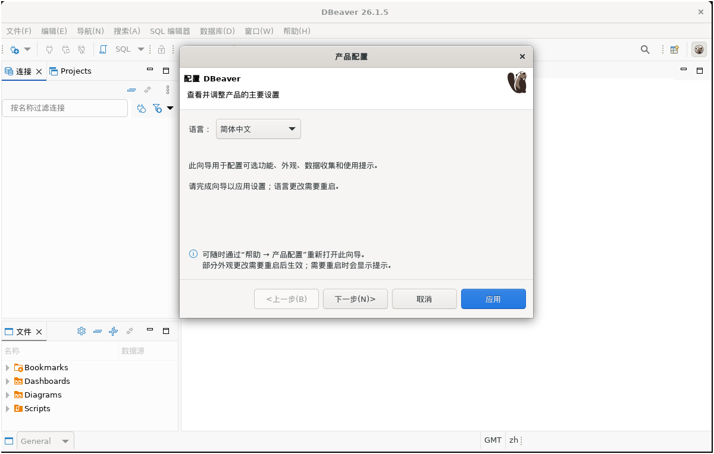

After the main window closes, background processes may need several seconds to save and release the workspace. Wait for the previous process to exit before starting another instance, or DBeaver may report `Can't lock workspace`.

## 5. Create the first connection and configure JDBC

Complete the connection before starting routine or Package debugging. See the [online illustrated manual](./GAUSSDB_GUI_OPERATION_MANUAL.md) for full-window screenshots and annotations, or download the Word manual for offline use.

1. Obtain the reachable server host, port, database name, account, and compatibility mode from the database administrator. The host is a database endpoint, not the client extraction directory.
2. Open **Database → New Database Connection**, or the new-connection toolbar action, and select the single **GaussDB** entry for both O/A/ORA and M databases. Add the matching JDBC JAR as described below.
3. Enter the connection details. For M databases, select **M compatibility: mCompatible=true, yearIsDateType=true**; leave it cleared for A/O databases. This sets JDBC properties for this connection and does not change the database compatibility mode. Run **Test Connection**, finish the wizard, and confirm that the connection expands in **Database Navigator**.
4. Expand the database and schema, check the tables and supported routines or packages, then follow sections 6 and 7 for debugging and compilation.


The distribution does not bundle a GaussDB JDBC driver. Use an organization-approved driver that matches the target database version:

1. Start DBeaver and select **Database** > **Driver Manager**.
2. Select **GaussDB** and choose **Edit**, or use **Edit Driver Settings** in the new-connection wizard.
3. Add the GaussDB JDBC JAR on the **Libraries** page.
4. The default configuration for commonly used `gsjdbc4.jar` is `org.postgresql.Driver` with `jdbc:postgresql:`. If the official JAR actually provides `com.huawei.gaussdb.jdbc.Driver`, configure it with `jdbc:gaussdb:` in the driver editor. Match the actual class and protocol; do not infer them from the filename or require a different JAR solely because the database is in O mode. Avoid conflicting driver versions.
5. Create a connection and enter the host, port, database, user, and password.
6. Run **Test Connection** and finish the wizard after it succeeds. Use SQL to query `version()`, `current_database()`, `current_user`, and `pg_settings.sql_compatibility` to confirm the actual target; the success dialog does not replace these queries.

The client does not silently alter private session parameters. If a server capability requires an additional parameter, the capability check or server error reports it explicitly so that a user or database administrator can review and set it deliberately.

Built-in GaussDB drivers disable “Thread safe driver” by default, serializing statements and result reading on each connection to avoid driver concurrency failures during multi-schema refresh. Separate connections remain parallel. If an old workspace or custom driver explicitly enables this option, disable it in Database → Driver Manager → Edit and reconnect. This is a client setting and does not alter database session parameters.

R3 exposes one **GaussDB** entry in the new-connection picker. The three previous driver definitions remain internally available for saved connections, and Driver Manager can still edit their configuration. The unified entry was tested with a matching `gsjdbc4.jar` on both architectures: real GaussDB 507 A/M connections, detected modes and saved/reopened M options passed. Separate JDBC checks covered temporary-table DDL, bound Unicode/SQL NULL and rollback. This does not establish acceptance of every driver version or M data type.

The unified new-connection picker, with legacy definitions retained for saved connections:

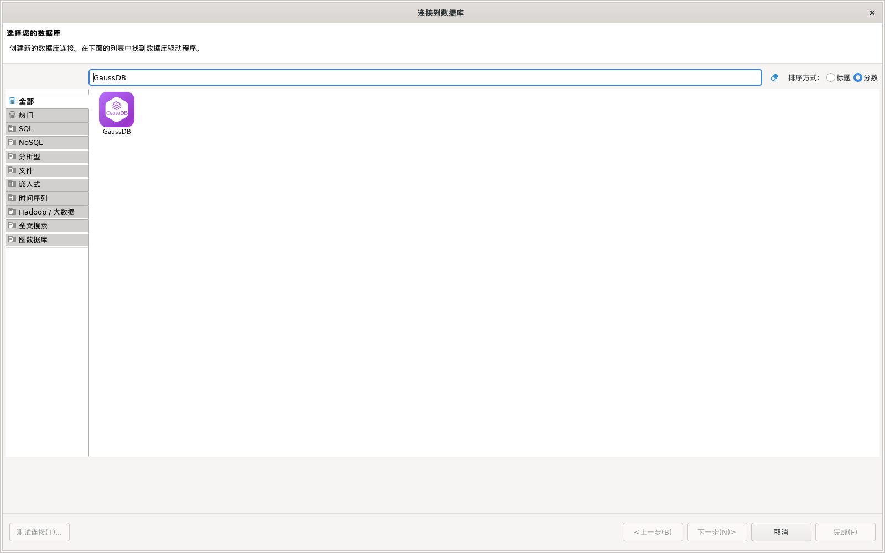

## 6. Debug a stored procedure or function

### 6.1 Start a debug session

1. In **Database Navigator**, expand the database, schema, and **Procedures** or **Functions** node.
2. Open the routine and save its source.
3. Double-click the editor ruler beside an executable line to add a breakpoint.
4. Open **Database** > **Database Debug...**, or the debug (bug) toolbar drop-down > **Database Debug Configurations...**, then create a database debug configuration. **Debug As** on a specific routine is another entry point.
5. Select the data source and routine, then provide values for all `IN` and `INOUT` parameters.
6. Choose **Debug**.

Enter composite arguments using the database type's text format, for example `(1,张三)`. Quote a field containing a comma with double quotes, for example `(2,"Alice, Jr.")`; do not wrap the whole input in SQL single quotes. The debugger resolves each parameter's actual type OID and qualifies user-defined type names with their owning schema, including when the routine and type are in different schemas. Built-in numeric and text arguments retain their existing call format.

To pass SQL NULL for the entire parameter, select SQL NULL in the input-mode column rather than supplying a string value. Composite objects still use text input; a field-by-field object editor is not provided.

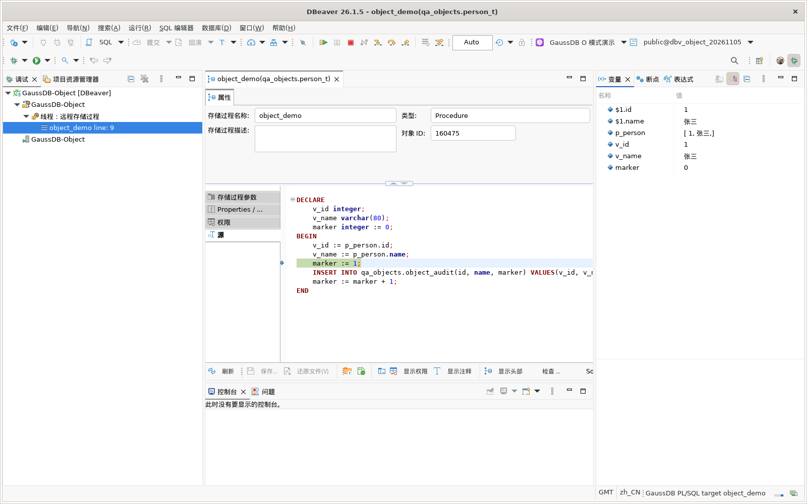

The generic **Run** > **Run Configurations...** menu remains available for other launch types; the database debug type is offered only in **Debug Configurations**. Execute ordinary SQL in the SQL editor. If an older build reports `No tab group defined` when creating an entry in **Run Configurations**, close that dialog, use the database debug entry above, and update to this build. Do not delete the workspace.

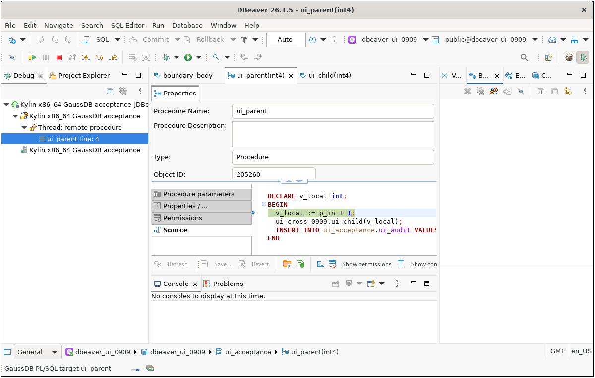

### 6.2 Execution control and variables

| Action | Shortcut | Description |
| --- | --- | --- |
| Step Into | F7 | Enter the procedure or function called by the current line |
| Step Over | F8 | Execute the current line without entering the callee |
| Step Return | Shift+F7 | Continue until the current call frame returns |
| Resume | F9 | Continue to the next breakpoint or completion |
| Terminate | F10 | Terminate the current debug session |

The **Variables** view displays local variables and permits supported values to be changed. The watch view accepts variable names. Server-rejected types, constants, and invalid values are displayed as errors and are never reported as successful updates.

Inspect cursor state:

1. Pause at a line after `OPEN`, `FETCH`, or `CLOSE` and open **Variables**.
2. Find the `refcursor` or `sys_refcursor` variable. When the server supplies recognized state data, its value shows a summary such as `(ROWCOUNT=1, ISOPEN=true, FOUND=true, NOTFOUND=false)`.
3. Expand the cursor to inspect the read-only `%ISOPEN`, `%FOUND`, `%NOTFOUND`, and `%ROWCOUNT` children. `NAME` is also shown when the server provides a portal name; Package cursors also expose `PACKAGE` to distinguish equal names from different packages. Missing attributes are never replaced with `false` or `0`; an explicit null is shown as `NULL`.
4. In **Expressions**, add the cursor variable name, such as `cur`, to inspect its complete state, or `cur%ROWCOUNT` / `cur%ISOPEN` to watch one attribute. Cursor names are case-sensitive; attribute names are case-insensitive. Only variable names and these attributes are supported; arbitrary expressions are not executed. If several packages expose the same cursor name in the selected frame, an unqualified attribute watch reports an ambiguous name. Expand the cursor with the matching `PACKAGE` in Variables instead.
5. Step and inspect the value at the next suspension. Selecting a different call frame displays that frame's state. Stepping no longer forces the visible **Expressions** tab to switch to **Breakpoints**.

The cursor and its state children are read-only. Unrecognized, conflicting, or ambiguous data remains visible as the original value or separate variable rows. The client only interprets data already returned by `info_locals()`; it does not issue an additional `FETCH`, rerun the original query, or set new private session parameters. **This is cursor-state inspection, not a cursor result grid. Result rows, original SQL, and column structure are not available during a pause and require a future server interface.**

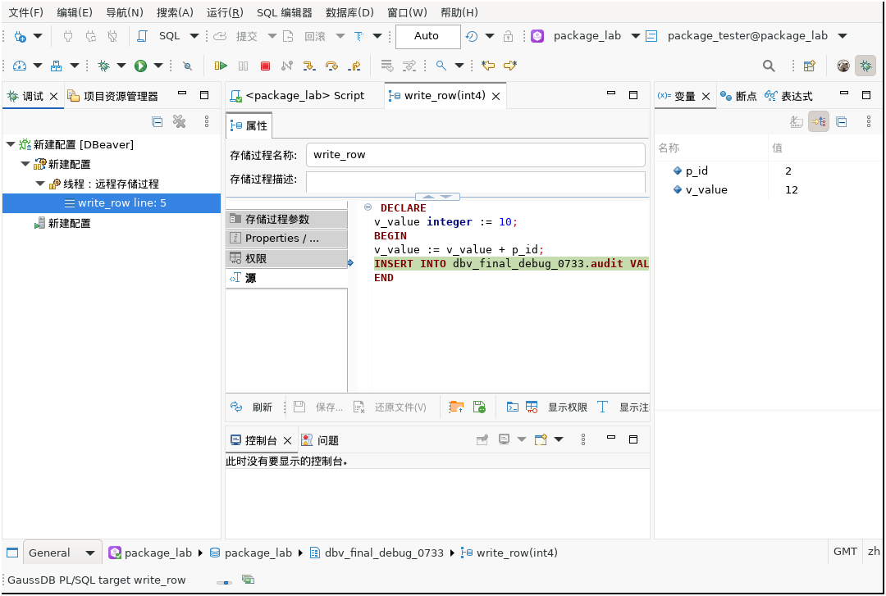

### 6.3 Call stack and transaction result

The **Call Stack** view displays nested routine calls. Selecting another frame refreshes source navigation and variables; double-clicking a frame opens the corresponding routine.

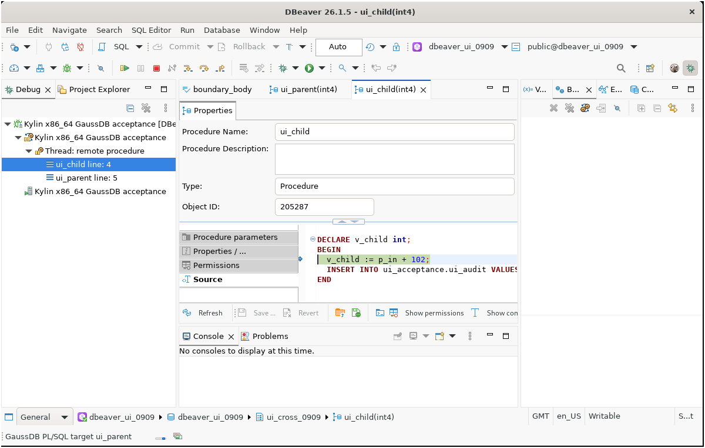

The completion dialog defaults to Rollback and applies only to the remaining open transaction on the target connection. A `COMMIT` already executed inside the routine cannot be undone by this final rollback; the choice applies to later changes that remain uncommitted. Commit/Rollback handles database data and does not save editor source. Save and compile source changes in the object editor before debugging.

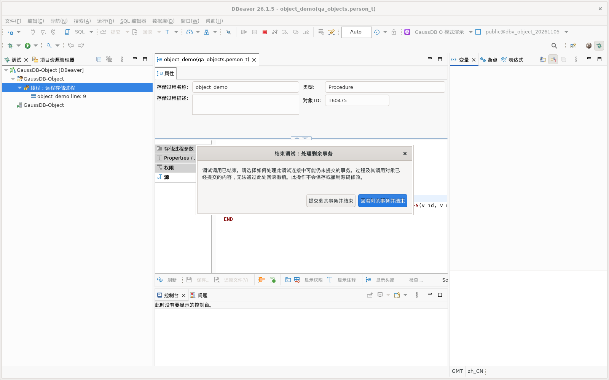

### 6.4 Selecting Package members

Package members are separate from standalone procedures/functions under a schema. In a new DBeaver debug configuration, select the connection, then expand Schema → target schema → Packages → target package → Procedures → target member in the routine chooser. Package functions are under the same package's Functions folder. For a member with no input parameters, an empty parameter table is expected.

Package member debugging requires a transaction-scoped `SET LOCAL search_path`. Review the setting and its scope on the configuration page, then optionally acknowledge it for this launch. Without that checkbox, choosing **Debug** opens a confirmation showing the connection, database, Package member and setting. Choosing **No** cancels the launch. Once an acknowledgement has been used, repeating the launch from the toolbar or a saved configuration requires a new acknowledgement. Restarting the client does not retain the previous acknowledgement.

**Apply** being disabled is normal when a saved configuration has no changes. **Debug** availability depends on a valid connection, routine and input parameters. Leaving the setting acknowledgement unchecked does not disable **Debug** for an otherwise valid configuration; confirmation is still required at launch.

### 6.5 Breakpoints and source tabs

The **Breakpoints** view retains configured breakpoints for the entire workspace after a session ends or the client restarts. It is not a log of breakpoint hits in the current execution. One connection can contain different databases, routines and lines, so identical connection labels do not by themselves indicate duplicates. Multiple records with the same connection, database, routine OID and line are duplicates.

Breakpoint labels include the connection identity, including when a custom label is used. Toggling a breakpoint at the same source line removes all matching duplicate records while preserving other connections. The client does not clear historical breakpoints automatically. Select unused breakpoints in the **Breakpoints** view to remove them, or uncheck them to disable them.

In **Breakpoints**, a single click selects a breakpoint; double-click to open its source and navigate to the breakpoint line. Merely switching to the Breakpoints or another view tab does not open source automatically. On initial or slow loading, execution-line and instruction-pointer positioning waits until the source document has loaded. After a source tab is closed or another view is selected, outdated asynchronous source results are ignored so the tab is not reopened and focus is not taken back.

### 6.6 Edit and save a stored procedure

Finish the current debug session and resolve the remaining transaction first. In Database Navigator, expand **connection → database → schema → target schema → Procedures**, double-click the routine, then select **Properties → Source**. Edit the complete `CREATE OR REPLACE` definition, press **Ctrl+S**, review the save SQL and confirm. Start a new debug session after saving; suspended code cannot be hot-replaced.

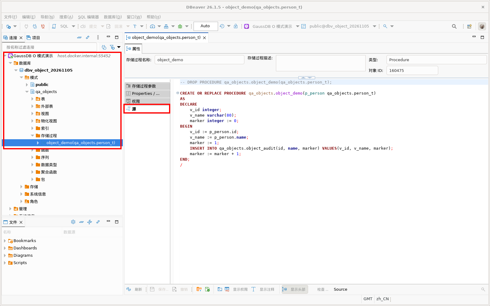

## 7. Package compilation and error navigation

1. Expand **Packages** under a schema in a Package-capable database.
2. Right-click a Package.
3. Select full Package, specification-only, or body-only compilation.
4. Review the compilation result and error list.
5. Double-click an error with a line number to navigate to the matching source line.

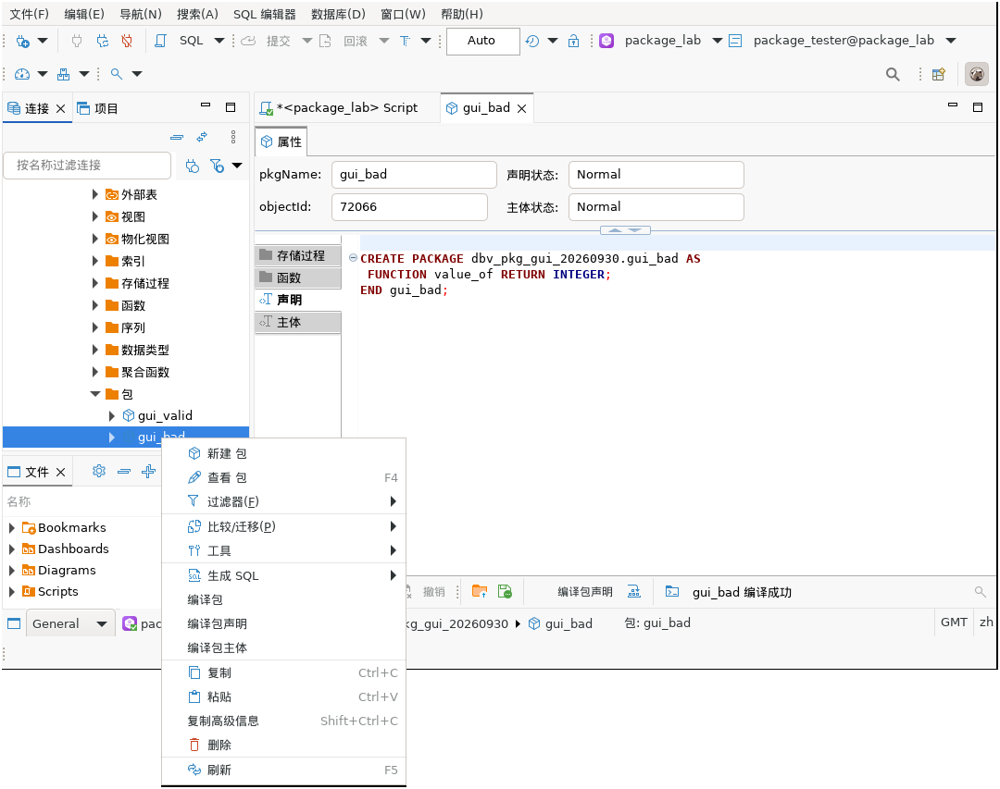

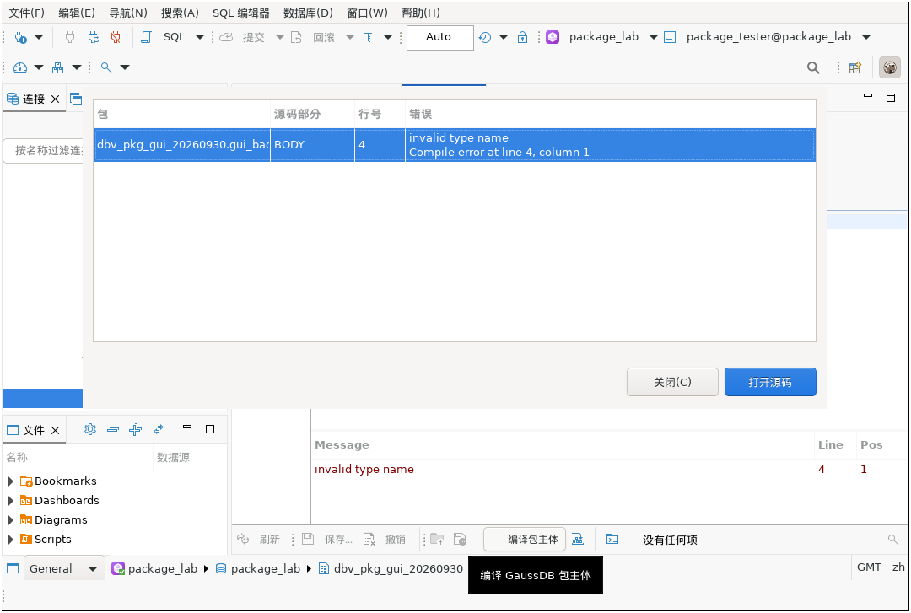

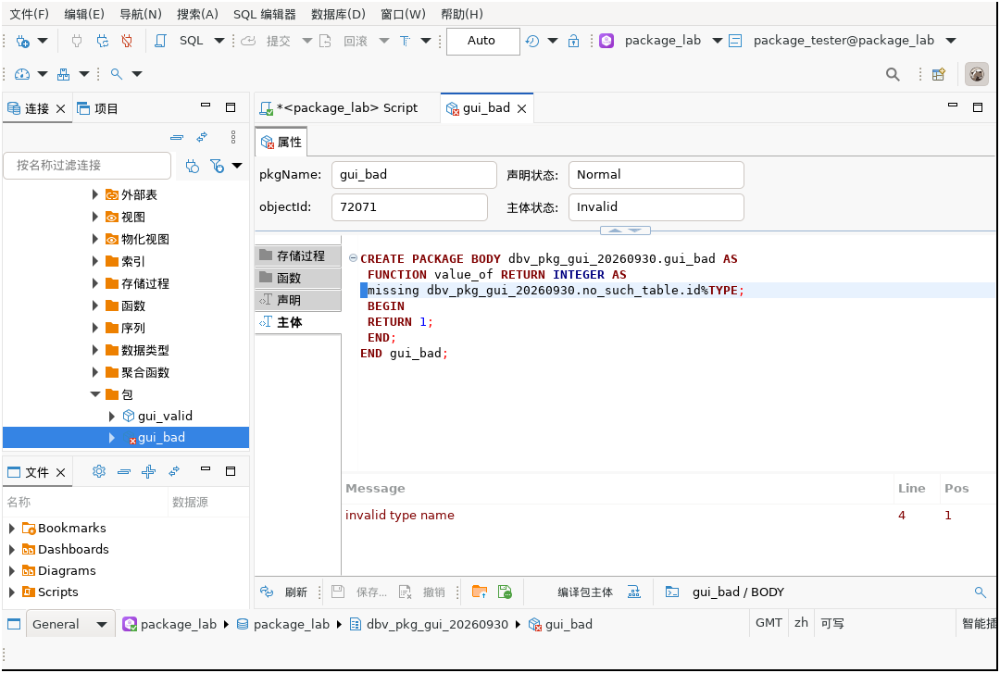

Multiple Packages can be selected in Database Navigator for batch deletion. The client displays the object list and asks for confirmation before execution.

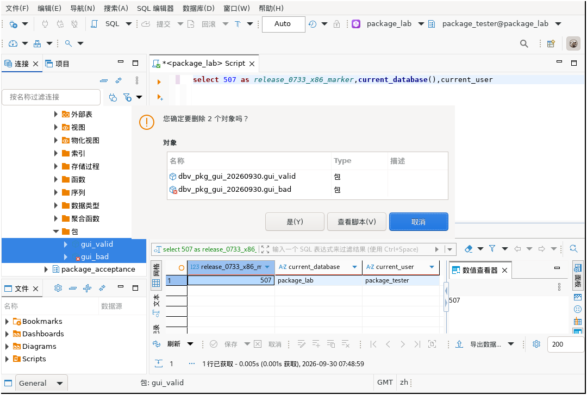

If a distributed server does not support forced invalid Package bodies or compilation diagnostic views, the client displays the direct server error and does not report compile-error navigation as successful.

## 8. Inspect partitions and subpartitions

1. In Database Navigator, expand **connection → database → schemas → target schema → Tables** and double-click the partitioned table.
2. On **Properties**, inspect **Partition key**, for example `RANGE (id)`, `LIST (region)`, `HASH (id)`, or `INTERVAL (event_date)`.
3. Select **Partitions** in the Properties sidebar to see first-level names and **Partition expression** boundaries. The table's **Partitions** folder in the navigator provides another entry point.
4. For a two-level table, expand **Partitions → first-level partition → Subpartitions**. Double-click the first-level partition and select **Properties → Subpartitions** to view child names and boundaries. Its own boundary and its children's partitioning key are displayed separately.
5. After a database-side partition change, select the parent table or partition and press **F5**. Check both the tree and the open list. A leaf without children does not expose an empty Subpartitions folder.

In these screenshots, `orders_nested` uses RANGE partitioning on `id`. Its `p_low` partition has boundary `VALUES LESS THAN (100)` and uses LIST subpartitioning on `region`; the child boundaries are `VALUES ('CN')` and `VALUES (DEFAULT)`. An unbounded RANGE partition displays `MAXVALUE`. Inspecting this metadata does not modify partition definitions.

Maximize the window and, when needed, close the right-hand Chat tab to make room for the name, partition key, and partition expression columns.

Actual client in the Kylin V10 x86_64 container:

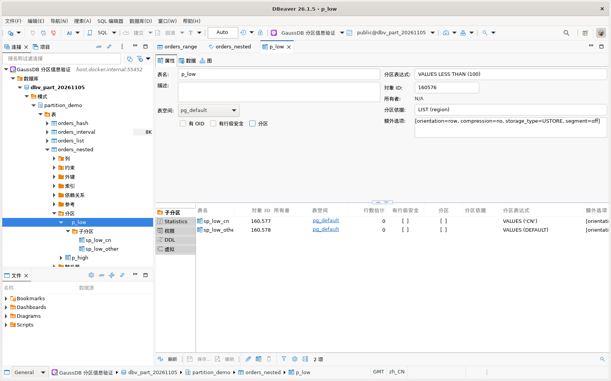

The same operation in the Kylin V10 ARM64 container:

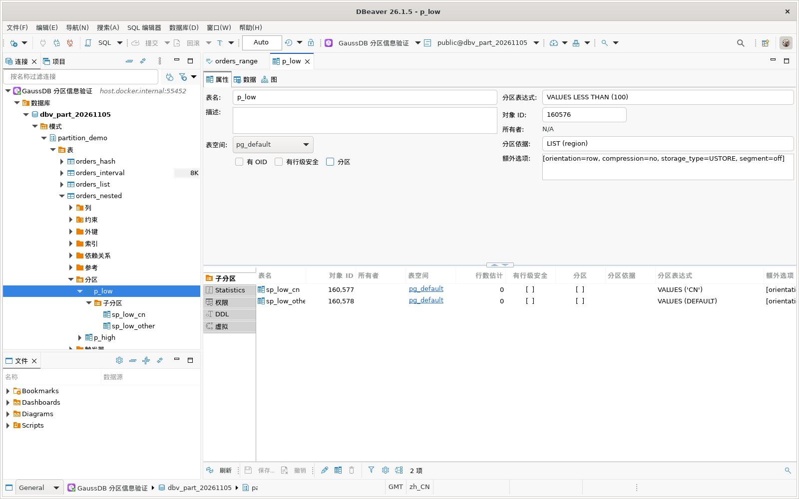

## 9. Validation results

### 9.1 R3 validation

- Restore partition properties in the table editor and display actual, correctly quoted column names. Read a partition's own boundary separately from its subpartition strategy; automatic INTERVAL partitions use range-boundary notation.
- Restore the subpartition tree and editor entry that was lost when the PostgreSQL navigator tree was inherited. The explicit physical-subpartition node is registered for GaussDB; PostgreSQL's original navigator remains unchanged.
- Refresh physical partitions from `pg_partition`, replace stale objects and update the parent cache, instead of treating partition OIDs as `pg_class` table OIDs.
- Main OSGi JUnit regression: **3,197 cases; 3,013 passed, 184 conditionally skipped, zero failures or errors**. Sixty partition, driver-visibility, saved-connection and JDBC-option cases were added. The complete suite ran on the build host; it was not rerun in full on ARM.
- All 43 packaging-script checks passed and all 204 product modules built successfully. Both archives were freshly extracted and passed their 1,202-entry application manifests.
- Both real GUIs ran in Kylin Linux Advanced Server V10 (Lance) containers against the same centralized GaussDB 507 ORA database. The x86_64 user space used host instruction translation; ARM64 used native ARM64 user space. Both containers share the host LinuxKit kernel.

| Client check in this round | x86_64 | ARM64 |
| --- | --- | --- |
| Startup and database connection | Passed | Passed |
| One GaussDB picker entry, real A/M connections and M capability gates | Passed | Passed |
| Saved/reopened M option, URL-conflict validation, driver class and JDBC properties | Passed | Passed |
| Seven-table matrix: RANGE, LIST, HASH, INTERVAL, quoted column name, ordinary table, two-level partition table | Passed | Passed |
| First-level expansion, Subpartitions entry, editor list and boundaries | Passed | Passed |
| Leaf hides an empty next-level entry | Passed | Passed |
| Same connection with cached children: add a subpartition, F5 changes tree and list from 2 to 3 | Passed | Passed |
| Drop that subpartition, F5 returns tree and list from 3 to 2 | Passed | Passed |

The seven tables' actual metadata, property descriptors and boundaries match line for line. All 451 identically named shared JARs in the two products match byte for byte. ARM coverage in this round is the GUI and metadata smoke comparison above; it does not establish full ARM acceptance of all historical debugging, Package, or customer virtual-desktop scenarios.

### 9.2 Historical validation records

The following results retain their original build dates. Newly executed R3 checks are listed above; complete historical GUI suites, 505-server checks and other environments were not rerun in this round.

Historical 2026-11-05 R2 was a connection-manual and source-delivery revision. Java plug-ins remain the R1 build; the R1 full-regression records below were not rerun for R2. Validation of the new connection walkthrough: A translated Kylin V10 x86_64 container connected to centralized 507 ORA using a fresh connection wizard, the native driver and a local JDBC jar; field entry, authentication without saved password, successful connection test, saved navigation, SQL queries confirming Kernel 507/current database/user/sql_compatibility=A, and the Error Log view were exercised. Thirteen complete-window screenshots were captured. The revised Word manual has 43 pages and 24 images, all visually checked.

Validation of the 2026-11-05 R1 build:

- Fix cross-schema composite argument calls by resolving the parameter's actual type OID and qualifying its owning schema. User-defined types no longer depend on the current search path; built-in type formatting is preserved.
- The completion dialog explains that only the remaining transaction is affected, prior commits inside the routine cannot be rolled back, and source code is not saved. Rollback remains the default.
- Main regression: 3,137 cases, with 2,953 passed, 184 conditionally skipped, zero failures or errors; seven regression cases were added since R6. All 204 product build modules succeeded. Fresh extraction passed all 1202 inventory entries, and 6 key production plugins byte-match the tested GUI copy.
- Centralized 507 ORA GUI checks: a Kylin V10 x86_64 container running through Rosetta/instruction translation and sharing the LinuxKit kernel debugged `(1,张三)` and `(2,"Alice, Jr.")`, paused, and displayed their fields correctly. After an actual commit, an independent connection read back the expected input values.
- SQL NULL and internal-COMMIT verification: A whole-object SQL NULL argument launched and completed successfully; an independent connection confirmed one committed row for each composite example and one SQL NULL row. On 507, `info_locals()` can display NULL composite fields as `0/<UNKNOWN>`; these placeholders are not claimed as exact field values. The internal-COMMIT scenario inserted 901 and committed, then inserted 902. Final rollback preserved 901, removed the uncommitted 902, and left no live debug target or process.

The following R6 and earlier results are historical records; their complete suites were not rerun for this build:

Validation of the 2026-11-03 R6 build:

- R6 cursor state: supports the inline state text returned by 507 `info_locals()` and the older name-based hidden-attribute format. Attributes are matched by complete cursor name, Package, and frame; missing, invalid, duplicate, or conflicting data is preserved rather than guessed. Cursor summaries and children are read-only; watches support the cursor and its `%ISOPEN`, `%FOUND`, `%NOTFOUND`, and `%ROWCOUNT` attributes.
- R6 watch refresh: retains stable variable and attribute snapshot identities. Suspension creates missing debug views without activating Variables or Breakpoints, preserving the visible Expressions tab.
- R6 main regression: 3,130 cases, with 2,946 passed, 184 conditionally skipped, zero failures or errors; this build adds 87 regression cases.
- R6 live protocol checks: centralized 507 ORA, covering OPEN, successful and unsuccessful FETCH, CLOSE, multiple cursors, and frame switching; 86 assertions per round, repeated twice with both rounds passing. The older name-based hidden format is unit-tested against supplied protocol fixtures; this release does not claim a new 505-server validation of that format.
- R6 product build and GUI acceptance: All 204 Maven modules built successfully. The final R6 GUI ran in a translated Kylin V10 x86_64 container with a fresh workspace connected to centralized 507 ORA. The real Variables and Expressions views refreshed the cursor and cur%ROWCOUNT watch after OPEN, the first and second FETCH, exhaustion with NOTFOUND, and CLOSE. Both views expanded all four state attributes and NAME with read-only protection. The selected frame, source caret, and execution annotation aligned at line 10. F9 completed normally; rollback left no live debug target or process, and the client exited normally. The six production bundles match the final GUI copy byte for byte; the extracted archive passed all 1,202 manifest entries. Same-frame cursor isolation and ambiguity across Packages are unit-tested; this combination is not claimed as GUI-validated.

The R5, R4, R3, and R2 entries below are historical records; their complete suites were not rerun with R6:

- R5 fixes debug completion state synchronization. Continue and stepping synchronize target and thread running states and clear stale stack frames; the next suspension reads a fresh stack. Resume is disabled while commit/rollback is pending, and outdated queued resume actions are ignored, preventing completed sessions from being treated as resumable paused sessions.
- R5 fixes completion detection during Package stepping. An independent JDBC protocol probe against a live 507 server found that reaching a child routine END can return `[EXECUTION FINISHED]` while child and caller frames remain. The client now matches the marker exactly and reads the backtrace on the same controller connection; a remaining stack is treated as a pause. It does not infer completion from routine OIDs, which may repeat in recursion. Routine completion requires the target CALL to return successfully; only the expected `D0005` backtrace state is treated as a completion signal, and other errors remain visible. This server behavior was confirmed by an independent protocol probe and the revised-client GUI checks below.
- R5 matches error-response markers exactly, so similar text inside source strings or comments is not mistaken for a debug failure. Genuine server error markers still terminate the debug session and report the error.
- R5 main regression: 3,043 total, 2,859 passed, 184 conditionally skipped, zero failures or errors; this build adds 45 regression cases (19 model-state and race cases, and 26 completion/error-marker cases). The R4, R3 and R2 GUI checks below are historical results and were not rerun with R5.
- R5 live GUI checks: a translated Kylin V10 x86_64 container connected to centralized GaussDB 507 ORA. R4 reproduced a completed state with two stack frames still present, followed by `not suspended` on Continue. In R5, F7 entered run_demo → build_result → calc_amount, crossed the server-reported build_result line 0, returned to run_demo line 8, and stepped to normal completion. A second run remained resumable and incomplete at build_result line 0; clicking Continue completed normally.
- R5 transaction checks: Resume and stepping actions were disabled while the final commit/rollback dialog was displayed. After the first run committed, an independent connection read one row. The second run rolled back, and the independent row count remained one.
- R5 product build: 204/204 Maven modules succeeded. The six production bundles involved in the repair are byte-identical to those used for GUI acceptance.

- R4 product build: 204/204 Maven modules succeeded. The extracted release archive passed manifest verification for 1,202 entries; the six production bundles involved in the repair match the GUI acceptance copy.
- Historical R4 main regression: 2,998 total, 2,814 passed, 184 conditionally skipped, zero failures or errors; R4 added 29 regression cases and retained the 69 cases added in R3.
- R4 live GUI checks preserve a real R3 workspace breakpoint across the version restart. Single-click selects without opening an editor. Cold double-click, double-click while the object is on Properties, and the Go to File context action all navigate to source line 6. An injected eight-second source-query delay still ends at line 6. Repeated single-clicks after closing all editors do not reopen source.
- R4 launch checks: Run Configurations lists only other runnable types. The saved database configuration in Debug Configurations remains valid with Debug enabled. An actual run_demo Package launch pauses with both caret and execution annotation at line 6, then continues to completion with rollback selected.
- R3 live GUI checks: explicit per-launch Package acknowledgement; declining leaves no live debug targets or processes. Initial suspend, double-click reopening and three-level F7 navigation place both caret and execution annotation at lines 6, 4 and 6. Closing source or using a native mouse click to return to Breakpoints remains stable for 10 seconds without reopening or focus theft.
- Previously completed in R2: Kylin V10 x86_64 GUI connected to a local centralized GaussDB 507 server: 100 bulk schemas, approximately 15,000 procedures, 3,000 functions, 208 packages and 3,900 synthetic composite types in the database.
- Previously completed in R2: each of two JDBC drivers completed three refresh rounds, with 500 tasks and 12 worker threads per round. The driver concurrency exception reproduced with the previous build did not recur.
- Previously completed in R2: M-mode main and metadata connection initialization, table data reading and debug parameter panel creation passed.
- R2 adds 23 regression cases. GUI checks cover restored duplicate breakpoints across restart, removing matches while preserving another connection, selecting run_demo in a new configuration, F7 into build_result and calc_amount with three frames, frame-specific variables and correct source, and F8 producing amount 30. Commit adds a row; a subsequent rollback leaves the row count unchanged.
- R4 and R3 GUI validation used a Rosetta-translated Kylin V10 x86_64 container on Apple Silicon and a centralized 507 ORA server. R2 previously checked a 505 JDBC driver against that server. These checks do not constitute 505 server or native x86 virtual-desktop acceptance.

The 2026-10-14 baseline previously passed centralized and distributed 505 live-database and independent acceptance checks. That full historical suite was not rerun for this repair build. Persistent loading in a target environment still needs an upgrade retest to establish whether its cause matches the repaired driver concurrency exception.

## 10. Current boundaries

- This release provides Kylin V10 x86_64 and ARM64/aarch64 packages. Windows and macOS packages were not built and accepted in this round.
- Historical object-parameter GUI coverage is limited to the composite examples above; it does not establish acceptance for every object, array or domain type. ARM coverage in this round is limited to section 9.1. Neither container comparison replaces acceptance on customer hardware, a native Kylin kernel or a virtual desktop.
- Locally rebuilt Linux native libraries in the package are not digitally signed. Verify integrity with the published SHA-256 digest and product manifest.
- GaussDB JDBC, `gs_dump`, `gs_restore`, and other native database tools are not distributed with the client.
- PL/SQL debugging depends on server debug APIs, compatibility mode, routine language, and user permissions.
- Package error navigation depends on Package and compilation-diagnostic capabilities in the target server version.
- Paused local cursors expose server-supplied state only. Result rows, original SQL, and column-structure previews require a future server interface. The older name-based hidden format is covered by protocol-fixture unit tests; the historical live-server cursor coverage uses the 507 inline format.
- Before first use in a target environment, verify the digest and run organization-specific connection, debugging, transaction, and Package acceptance tests.

## 11. Build from the delivered source

The complete source archive contains sibling `dbeaver/` and `dbeaver-common/` directories. The latter is pinned to official commit `2df03e58480c6325732f476e8355e375cec5405e`; do not replace it with a moving branch. See the [component record](./SOURCE-REVISIONS.json) and the archive's `SOURCE-MANIFEST.json` for revisions and origins.

Install JDK 21+ and Maven 3.9.x, extract the source archive, and enter its `dbeaver` directory. Replace the JDK path below with the actual installation path and confirm that `mvn -v` uses Java 21+:

```bash
export JAVA_HOME=/absolute/path/to/jdk-21
export PATH="$JAVA_HOME/bin:$PATH"
java -version
mvn -v
mvn -f product/aggregate/pom.xml -Pproduct-dbeaver-ce package \
  -DskipTests=true -Dskip-checkstyle=true -Dspotless.check.skip=true \
  -DforceContextQualifier=20261105r3 \
  -Dbuild-timestamp=20261105r3
```

The application qualifier is `20261105r3`, and the delivery revision is `20261105-r3`. `-DskipTests=true` packages the product without executing tests. Maven/P2 dependencies must be reachable or available in a complete, matching offline cache; downloading the source alone does not guarantee an automatic offline build.

The command builds the Java/Eclipse product. Recreating the Kylin archive additionally requires matching native libraries, pinned SWT/Equinox sources, JRE, Node.js 22+, and assembly tools. See `product/community/kylin/README.zh-CN.md` and `THIRD-PARTY-SOURCES.md` in the source. Auditable source and platform build validation do not imply byte-identical rebuilds. Upstream and historical Markdown files remain source material; use the linked V1.10 manual for customer operations.

## 12. Licensing

DBeaver Community source and these enhancements are provided under the applicable Apache License 2.0 terms. Bundled third-party components remain under their respective licenses; third-party source and license information is included in the package.

For the unified entry, omit `mCompatible` and `yearIsDateType` from URL query strings. The connection page rejects these conflicting URL parameters; use the explicit M option or the Driver properties page.
